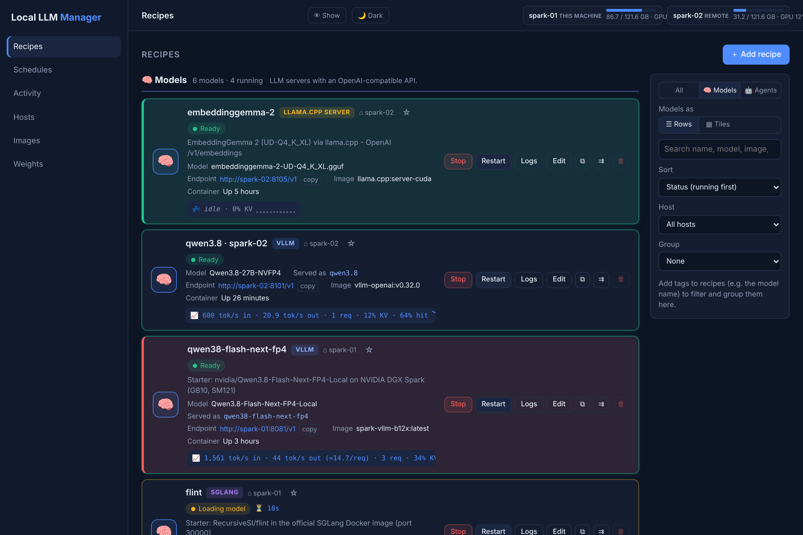
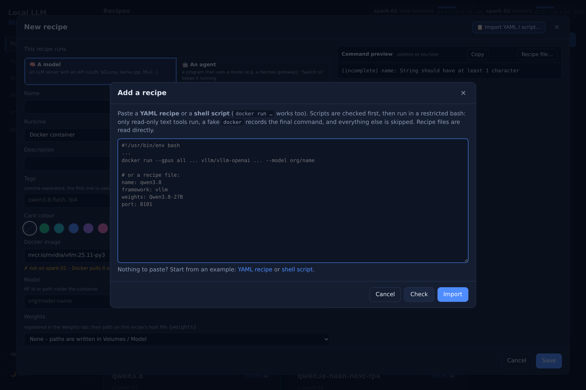
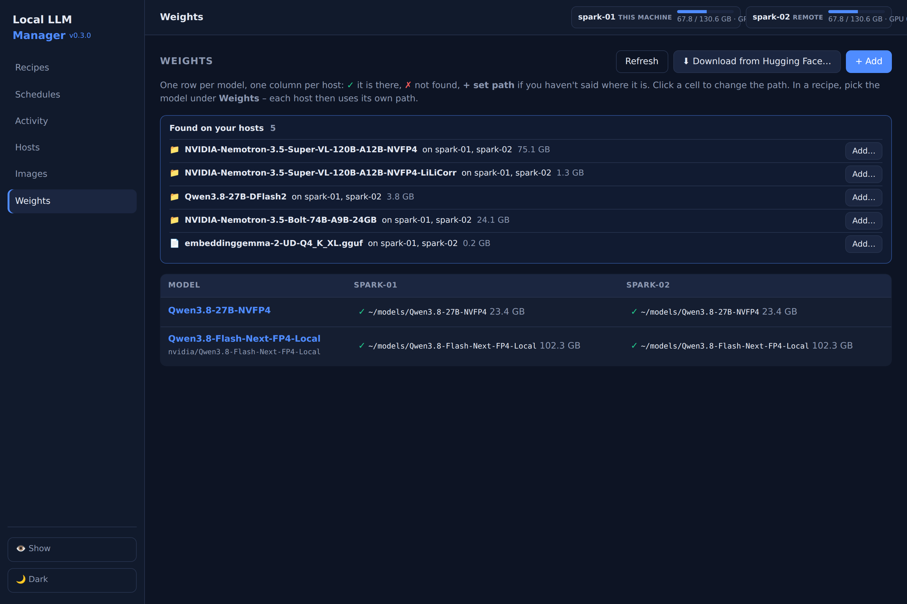
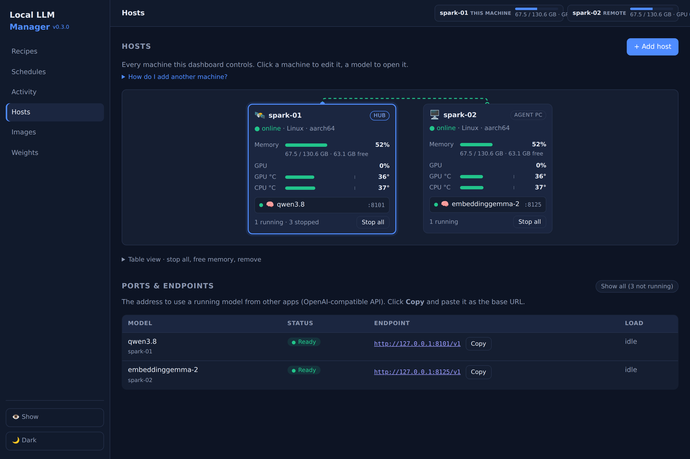
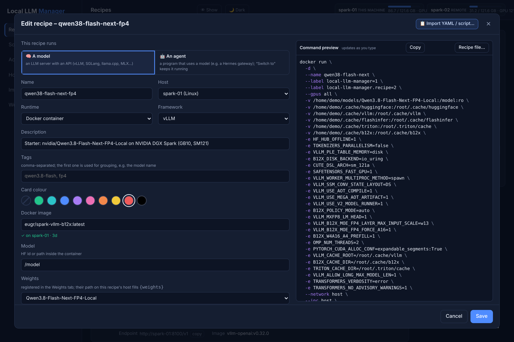
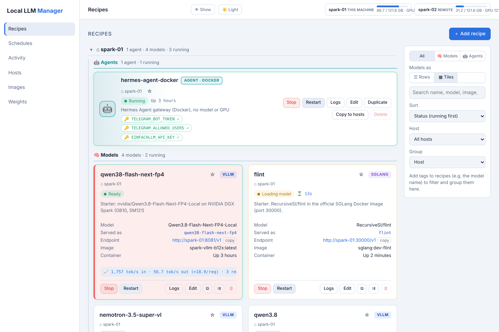
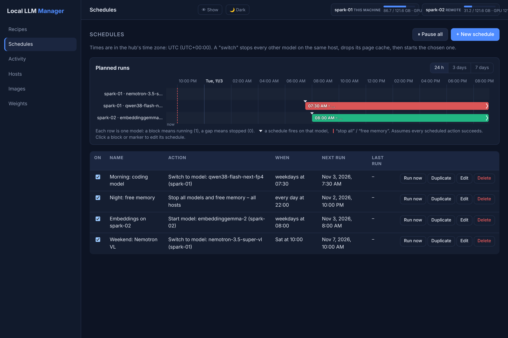

# Local LLM Manager

[](https://github.com/einfachllm/local-llm-manager/actions/workflows/ci.yml)
[](https://github.com/einfachllm/local-llm-manager/releases)
[](LICENSE)

A small web dashboard to run local LLMs on your own machines - an NVIDIA DGX Spark, a Mac with Apple
silicon, or any Linux box - from any browser on your network:



📖 **Documentation:** [einfachllm.github.io/local-llm-manager](https://einfachllm.github.io/local-llm-manager/) – start with the Quick start and Several machines.

### Highlights

- **⚙️ One place for recipes across the broad inference engines:** **vLLM**, **SGLang**, **llama.cpp**
  (Docker or native), **MLX** on Apple silicon and **TensorFold** (experimental) - plus any other Docker
  image or native binary. Each engine has a preset (image, command, port, health check), so a recipe
  only lists what differs.
- **📋 Recipes from YAML or a shell script.** **＋ Add recipe** takes a short YAML recipe or the start script
  / `docker run` you already have - no forms. Only what differs from the engine's defaults is written down.
  **Recipe file…** exports any recipe as YAML/JSON, so you can move it to another manager, keep it in Git or
  share it; on one dashboard, **⇉** copies a recipe to other hosts and keeps the copies in sync.
  [More](https://einfachllm.github.io/local-llm-manager/stable/recipes/)
- **📦 Weights management.** One table shows which model is where on every machine and finds folders and
  `.gguf` files on its own. **⬇ Download from Hugging Face** once, then **⇉ copy to other hosts** machine to
  machine over your network (snowball-style, SHA-256 checked, resumable). Recipes use `{weights}`, so they
  run on any host without edits. [More](https://einfachllm.github.io/local-llm-manager/stable/weights/)
- **🔗 Hub and agents.** Start the hub, install the same app on your other machines in agent mode, and
  connect them with a token - or let them ask to join (`DGXM_HUB_URL`) and approve them when both show the
  same join code. [More](https://einfachllm.github.io/local-llm-manager/stable/several-machines/)
- **🗺️ Hosts at a glance.** The Hosts tab draws the hub and every agent PC as a graph: memory, GPU load,
  GPU and CPU temperature, what runs where, and whether each connection is encrypted. **Ports & endpoints**
  lists the running models' endpoints with live tokens/s, requests and KV-cache use (a *Show all* switch
  adds the stopped ones).

### Everything else

- **Start, stop, restart, or "switch to"** a model (stops the others on that machine and frees memory first).
  A running model's runtime settings are locked - stop it before changing ports, command, image or
  environment, so the card always matches what runs.
- **Agents next to models:** run the programs that use your models - e.g. a [Hermes Agent](examples/hermes-agent/)
  Telegram gateway - as recipes too. They get their own section per host (🤖 above 🧠), keep running when you
  switch models, and show whether their secrets are set and whether a stray second copy is running.
- **Live status, logs and stats:** loading/ready/failed, tokens/s with a throughput sparkline, running
  requests, KV cache usage - and an estimate of how long a start typically takes (measured trigger → ready).
  Container logs stay bounded by default (50 MB × 3).
- **Schedules:** start, stop or switch models at set times, with a timeline of what will run when.
- **Images:** see which Docker images your recipes use, whether each host has them, pull them on several
  hosts at once, and switch recipes to a newer local tag (e.g. a fresh vLLM nightly) with one click.
- **Health findings:** memory almost full, a hot GPU, a KV cache that makes requests wait, a host that
  stopped answering, or a start that failed - with the cause from its log (e.g. *CUDA out of memory*) and
  what usually helps - shown on the card, the host and in the activity log. Mute one for 24 h.
  [More](https://einfachllm.github.io/local-llm-manager/dev/health/)
- **Activity log** of every start, stop and switch with the command and result (values of explicit
  `KEY=value` environment lines are masked).
- **Screen-share friendly:** a blur toggle hides IP addresses and host names; dark, light and auto themes;
  ⭐ pinned recipes (shown in a dedicated “Pinned” section at the top), collapsible groups, larger recipe
  cards, and keyboard shortcuts (`?` shows them). Blur and theme toggles live in the left sidebar.
- **Recipe toolbar:** filter recipes by engine (vLLM, SGLang, llama.cpp, MLX, TensorFold, Custom –
  derived automatically from your recipes), by model/agent kind, by host, by tag; group by host,
  engine, host → engine or tag; and sort by name, status, port or last-edited. Search across name,
  model, description, host, image, container name, framework and tag.

Model weights and Docker images must be on the machine that runs them. The manager can pull images and
download / copy weights for you (Images and Weights tabs), or you put them there yourself.

## Use cases

Who it is for:

- **Your best model recipes in one place, whatever the engine.** Keep every working setup - vLLM,
  SGLang, llama.cpp, MLX or TensorFold (experimental), with its image, flags and port - as a recipe you can
  start with one click, instead of scattered shell scripts and notes.
- **No Docker or shell needed.** Paste one of the [example recipes](examples/recipes/) into **＋ Add recipe**,
  let the Weights tab download the model, and press **Start**. You never write a `docker run` yourself.
- **LLMs on different machines.** A DGX Spark, a Mac Studio and a Linux PC in one dashboard: each runs the
  engine that suits it (vLLM / SGLang on the Spark, MLX on the Mac), and recipes move between them.
- **Machines with little disk space.** The Weights tab tracks which model is on which machine and how big
  it is. Copy a model to a machine only when you need it there, and see right away what each one holds.

More examples:

- **Run local AI servers for clients:** add each client's machine as a host (over Tailscale) and roll out a
  recipe or an updated one - new image, model or flags - from one dashboard, then restart it there.
- **Save energy at night:** a schedule stops your models (or frees the memory) in the evening and starts
  them again in the morning; the timeline shows when what runs.
- **Test a recipe across your stack:** duplicate it to the Spark, the Mac Studio or a client box, start it
  and compare readiness time, tokens/s and KV cache side by side.
- **Switch models for your agents:** give the recipes on a machine the same port, and **Switch to**
  replaces the running model in one step - your agents keep the same endpoint `http://<host>:<port>/v1`.

## Examples

- [Importable recipes](examples/recipes/): paste-ready model recipes - e.g. Qwen3.8-Flash-Next-FP4 with
  vLLM on a DGX Spark - into **＋ Add recipe**, no field-typing needed.
- [Hermes Agent](examples/hermes-agent/): a full personal agent on Telegram with local speech-to-text and
  text-to-speech, running on a model from this manager; the Hermes gateway itself is an agent recipe (native
  process or Docker).

## Screenshots

| Add a recipe: paste YAML or a script | Weights on every host |
|---|---|
|  |  |

| Hosts graph, ports & live metrics | Recipe editor with command preview |
|---|---|
|  |  |

| Light theme, grouped by host, tiles | Schedules & planned-runs timeline |
|---|---|
|  |  |

The screenshots show a demo setup: a hub `spark-01` and an agent `spark-02`. The **🙈 Blur** toggle in the
left sidebar replaces host names and IPs with aliases such as `host-3f2a` - handy for screenshots and screen shares.

## Quick start

Requirements: Python 3.10+ and, for Docker recipes, Docker (with the NVIDIA runtime for GPUs) usable by
your user without `sudo`.

**Linux** (installs a systemd service running as your user):

```bash
git clone https://github.com/einfachllm/local-llm-manager.git
cd local-llm-manager
./install.sh          # prints a generated password (stored in .env in this folder)
```

**macOS** (installs a launchd agent; Docker on a Mac cannot use the GPU, so use native recipes such as
MLX - `pip install mlx-lm` - or `brew install llama.cpp`; also `brew install bash` for script import):

```bash
git clone https://github.com/einfachllm/local-llm-manager.git
cd local-llm-manager
./install-macos.sh    # prints a generated password (stored in .env)
```

**Docker Compose** (Linux, Docker recipes only):
`cp .env.example .env`, set `DGXM_PASSWORD` (at least 12 characters, e.g. `openssl rand -base64 18`),
then `docker compose up -d`. This uses the image
`ghcr.io/einfachllm/local-llm-manager:latest` (amd64 + arm64); add `--build` to build it yourself.
The base file runs on any host. On NVIDIA hosts, add the override for GPU readings in the Hosts graph:
`docker compose -f docker-compose.yml -f docker-compose.nvidia.yml up -d` (models get their GPUs via
their own `--gpus` flag, not through this reservation). For Tailscale mode, use
`docker compose -f docker-compose.yml -f docker-compose.tailscale.yml up -d` - it mounts the host's
Tailscale binary and daemon socket (both paths must exist on the host).

Run the two installers as your normal user, **not with `sudo`** - they ask for `sudo` themselves where
the service file needs it; under sudo the service would run as root.

Then open `http://<machine>:8090` and log in as `admin` with that password. To change it, edit the env file
(at least 12 characters, no well-known passwords) and restart the service.

## Upgrading

Your recipes, schedules and settings stay where they are (`data/manager.db` and your `.env`). Running
models keep running while the manager restarts.

```bash
cd local-llm-manager
git pull                  # or a release: git fetch --tags && git checkout v0.3.0
./install.sh              # Linux; on macOS: ./install-macos.sh
```

With Docker Compose: `docker compose pull && docker compose up -d` - with the same `-f` override files
you started it with (e.g. `-f docker-compose.nvidia.yml`).

If the service does not start after an upgrade, check its log: newer versions refuse weak passwords
(under 12 characters) and agent tokens under 32 characters. On macOS the service then stays stopped
instead of restarting in a loop (a `data/.config-fault` marker holds launchd back); fix `.env` and
rerun `./install-macos.sh`.

Upgrade the hub and all agents to the same version. Read the [CHANGELOG](CHANGELOG.md) before
upgrading, and copy `data/manager.db` first if you want to be able to go back.

## Uninstalling

```bash
./uninstall.sh            # Linux; on macOS: ./uninstall-macos.sh
```

This removes the service; your `data/manager.db`, `.env` and `.venv` stay in place (so a reinstall
just works). Add `--purge` to delete those as well. Models that are currently running keep running -
stop them in the dashboard first if you want them gone too.

With Docker Compose: `docker compose down` (your data is in `./data`, delete it if you want).

## Several machines

One installation is the **hub**: it serves the dashboard and stores recipes, schedules and the activity
log. Every other machine runs the same app as an **agent** that only executes what the hub tells it to.

```text
 your browser ──▶ HUB :8090  (dashboard, recipes, weights, schedules)
                   ├──▶ AGENT :8090  e.g. Mac Studio      ─┐ weights are copied
                   └──▶ AGENT :8090  e.g. second Spark    ─┘ agent to agent
```

1. **Start the hub:** install as in [Quick start](#quick-start) - that machine is the hub.
2. **Install an agent** on the other machine and uncomment these lines in its `.env`; the installer already
   filled in a random token (at least 32 characters). Then rerun the installer:
   ```bash
   DGXM_MODE=agent
   DGXM_AGENT_TOKEN=3f9c…              # generated
   DGXM_HUB_URL=http://<hub>:8090      # optional: ask the hub to be added
   ```
3. **Connect it**, either way:
   - **It asks to join** (with `DGXM_HUB_URL`): the agent prints a **join code** such as `K7Q2-X9PM`
     (installer output, log, its start page). On the hub it shows up under **Hosts → Asking to be added**
     with a code - click **Codes match – add** if both are the same.
   - **You add it:** **Hosts → + Add host** with the agent's URL (e.g. `http://mac-studio:8090`) and the
     same token.

Recipes then get a **Host** field, and the agent appears in the Hosts graph.
Step by step: [Several machines](https://einfachllm.github.io/local-llm-manager/stable/several-machines/).

**Network access needed:**

| From | To | Why |
|---|---|---|
| Your browser | hub, port `8090` | The dashboard |
| Hub | each agent, port `8090` | Start/stop models, status, logs (plain HTTP + token) |
| Apps using a model | the machine running it, the recipe's port (e.g. `8100`) | The model's OpenAI-compatible API at `http://<machine>:<port>/v1` |

Agents connect to the hub only to ask to be added (`DGXM_HUB_URL`), and to each other only to copy weights. Keep all of
this inside one private network - ideally Tailscale (next section) - and never expose these ports to the
internet.

## Recommended: Tailscale only (also from your phone)

[Tailscale](https://tailscale.com) puts all your machines and your phone into one private, encrypted
network, so the dashboard, the agents and the model APIs are reachable from anywhere - but only by your
own devices. It also encrypts the hub ↔ agent traffic, which is otherwise plain HTTP.

1. Install Tailscale on every machine (hub, agents) and on your phone, logged in to the same tailnet.
2. On every machine, add to its `.env` and restart the manager:
   ```bash
   DGXM_HOST=tailscale         # the manager listens only on this machine's Tailscale IP
   DGXM_PUBLISH_IP=tailscale   # model ports too (docker -p 100.x.y.z:port, native servers via {bind_host})
   ```
3. Add agents under **Hosts → Add host** by their Tailscale name, e.g. `http://mac-studio:8090`.
4. On your phone, open `http://<hub-name>:8090` (e.g. `http://spark:8090`) and use *Add to Home Screen*.
   For HTTPS, run `tailscale serve --bg 8090` on the hub and open `https://<hub-name>.<tailnet>.ts.net` -
   `serve` proxies to `localhost`, so keep the manager listening there (e.g. `DGXM_HOST=127.0.0.1` or
   `0.0.0.0`); with `DGXM_HOST=tailscale` it binds only the Tailscale address and `serve` cannot reach it.

`tailscale` is resolved to the machine's address (`tailscale ip -4`) at start-up; if Tailscale is not up
yet, the service fails and systemd / launchd retry. A Docker Compose hub needs the Tailscale override
for that: `docker compose -f docker-compose.yml -f docker-compose.tailscale.yml up -d`. Keep
`DGXM_PASSWORD` set anyway: your phone's browser visits other sites too. Recipes created before this
setting existed may contain `--host 0.0.0.0` in their command; change it to `--host {bind_host}` for
native-process and `--network host` recipes.

## Recipes in short

- Pick a **framework preset** (it fills in image, command, port and health check), then adjust the model,
  arguments, environment and volumes. The editor shows the exact `docker run` command.
- In the command, `{model}`, `{port}`, `{host_port}`, `{name}`, `{bind_host}` (listen address) and `{weights}`
  are replaced; an unknown placeholder such as `{modle}` is refused at start and in the preview instead of
  reaching the engine. An environment line with only a name (e.g. `HF_TOKEN`) takes the value from the
  manager's own `.env`, so secrets stay out of recipes.
- **Native process** recipes run the command directly on the machine (needed for MLX on a Mac). Output
  goes to `data/processes/<name>.log`, and processes keep running if the manager restarts.
- **Import** fills a recipe from a starter script by running it with bash in a restricted mode that only
  records `docker run` / the server command and skips other commands. It is not a sandbox: *Check*
  lists risky lines first. Calls the restricted run merely skips are shown for information; risks it
  cannot block need an explicit "I trust this script". It also accepts a **compact JSON/YAML recipe
  file** (the editor's fields; missing settings come from the framework preset), and **Recipe file…** in
  the editor exports the current recipe that way - volumes, environment and extra Docker flags included.
- **Moving recipes:** change a recipe's **Host** to run it elsewhere (with `{weights}` the model folder
  follows), **⇉** to copy it to several hosts, or **Recipe file…** → paste into **＋ Add recipe** to take it
  to another manager. See [Recipes](https://einfachllm.github.io/local-llm-manager/stable/recipes/#move-recipes-between-machines-and-managers).
- Live stats come from the server's `/metrics` endpoint: on by default in vLLM and TensorFold; the
  SGLang and llama.cpp presets turn them on (`--enable-metrics` / `--metrics`).
- Starting is refused if the port is already in use on that machine.

### Models and agents

The editor's first choice, *This recipe runs*, sets what a recipe is:

- **A model** - an LLM server with an API (vLLM, SGLang, llama.cpp, MLX, …): the usual recipe.
- **An agent** - a program that *uses* a model, e.g. a Hermes gateway (native or Docker). It is listed in
  its own 🤖 Agents section (per host when grouped), has no endpoint or engine stats, and needs no GPU or
  health path (running = its process/container is up; the port may be a placeholder). **Switch to** on a
  model stops only the other *models* on that host, and agents themselves have no **Switch to**; "stop all"
  and "free memory" stop agents too. The card shows each passed-through secret name (a bare `KEY` line in
  *Environment*) with ✓ or ✗ - whether the manager's environment on that host has it; values are never
  shown - and, for native agents, warns when the same command also runs outside the manager.

### Weights on several machines

Model weights are often in a different folder on each machine. Register them once in the **Weights** tab
and set the path per host (e.g. `~/models/Nemotron-VL` on one Spark, `/mnt/nvme/nemotron-vl` on another).
In a recipe, pick the entry under **Weights** and write `{weights}` where the path goes - usually the
volume `{weights}:/model:ro` (picking an entry adds it), or the model itself for native recipes. When the
recipe starts, `{weights}` becomes that host's path, so moving a recipe to another host needs no edits.
The editor shows right away whether the weights are on the selected host, and starting is refused when a
host has no path set or nothing at that path. `~` in a path is the home directory of the machine that runs
the recipe.

You rarely type paths by hand: opening the tab (or **Refresh**) looks for model folders (with
`config.json` or weight files) and `.gguf` files in each host's `DGXM_MODEL_DIR` (default `~/models`, up
to three levels deep) - plus LM Studio's model library (`~/.lmstudio/models`) when the host has one - and
lists what it can add under **Found on your hosts**, one click each: a path for
an entry that has none on a host (a folder there with the same name as the entry's folder elsewhere, or its
name / source repo), folders nobody added yet, and recipes that mount their model folder directly (e.g.
`~/models/x:/model:ro`) - adding those creates the entry (or reuses one of the same name) and switches the
recipes to `{weights}`. A model missing on some hosts gets one button: **⇉ Copy to other hosts…** when a
host has it, else **⬇ Download…** from Hugging Face. Importing a `docker run` whose model mount is a registered path picks that entry, too.

The full guide - the table, downloading from Hugging Face and copying between hosts - is on the
[Weights](https://einfachllm.github.io/local-llm-manager/stable/weights/) page.

Not to be confused with **agent mode** ([Several machines](#several-machines)), which is how the manager itself runs on a second machine.

## Schedules and time zone

A schedule repeats (weekdays + time, or a cron expression like `0 22 * * 1-5`) or runs once.
Actions: start, stop, restart, switch to a model, stop all models, stop all and free memory.

**All schedule times are in the hub's time zone**, not your browser's. The Schedules tab shows which
one it is, e.g. `CET (UTC+01:00)`. With `install.sh` / `install-macos.sh` that is the machine's system
time zone; the Docker Compose file mounts the host's `/etc/localtime` for the same result (without it, a
container runs in UTC). For DST-correct schedules the zone must also be resolvable by name: on hosts
where `/etc/localtime` is not a symlink, set `TZ` in the Compose file (see its comments) or uncomment
the `/etc/timezone` mount (Debian/Ubuntu). Change the zone with `sudo timedatectl set-timezone Europe/Berlin`
on Linux, then restart the manager.

If the hub was off when a repeating schedule was due, that run is skipped; a missed one-time schedule
still runs if it is less than 10 minutes late.

DST transitions are handled: when the clock goes back, a repeated time (e.g. 02:30 twice) fires once
for daily or weekly schedules - an hourly schedule keeps its rhythm and runs in both occurrences. When
the clock springs forward, a schedule at a non-existent time (02:30) runs at the transition (03:00).
The hub resolves its zone by name from `TZ`, the `/etc/localtime` symlink or `/etc/timezone`; if none
resolves it falls back to a fixed offset, which is correct for UTC but cannot see transitions.

## Security

Anyone who can log in to the dashboard, or who knows an agent's token, can run any container or command
on those machines - effectively root. So: always set `DGXM_PASSWORD`, use a long random agent token, and
keep everything on a trusted network or VPN (or behind an HTTPS reverse proxy). Report vulnerabilities
as described in [SECURITY.md](SECURITY.md).

Built-in protections: the installers generate a random password; the hub refuses to start with a password
under 12 characters or a well-known one (`change-me`, `admin`, …), an agent with a token under 32 characters;
after 10 wrong logins within 10 minutes an address is locked out for the rest of that window (logged);
the database (it stores agent tokens) is readable by its owner only; requests that change
something are only accepted from the dashboard itself (other websites cannot use your browser's saved
login), and the dashboard cannot be embedded in other sites. Without a password it only answers when
opened by IP address, `localhost` or a local/Tailscale name. Behind a reverse proxy, pass the original host (`X-Forwarded-Host`).

## Configuration

Set in `.env` in the install folder (used by both installers, `run.sh` and Docker Compose); restart the
service after changes (`sudo systemctl restart local-llm-manager`, or rerun the installer):

| Variable | Default | |
|---|---|---|
| `DGXM_PASSWORD` / `DGXM_USER` | *(empty = no login; requests must be addressed to an IP, `localhost` or a local/Tailscale name)* / `admin` | Dashboard login, at least 12 characters |
| `DGXM_PORT` / `DGXM_HOST` | `8090` / `0.0.0.0` | Listen address; `tailscale` = Tailscale IP only |
| `DGXM_PUBLISH_IP` | *(empty = all interfaces)* | Address model ports are published on; `tailscale` = Tailscale IP |
| `DGXM_MODE` | `hub` | `agent`: no dashboard, controlled by a hub |
| `DGXM_AGENT_TOKEN` | | Token the hub must send (required in agent mode) |
| `DGXM_METRICS` | *(off)* | `1`: serve the manager's own metrics at `/metrics` (Prometheus format) |
| `DGXM_DB` | `./data/manager.db` | SQLite database (relative to the working directory) |
| `DGXM_STOP_TIMEOUT` | `30` | Seconds to wait on stop before killing |
| `DGXM_SEED` | `1` | Add the qwen3.8 example recipe to an empty database |
| `HF_TOKEN`, … | | Passed to recipes that list the bare name in their environment |

Less common: `DGXM_HEALTH_HOST` (`DGXM_PUBLISH_IP`, else `127.0.0.1`), `DGXM_PROC_DIR` (`<db folder>/processes`),
`DGXM_DROP_CACHES_IMAGE` (`busybox:latest`), `DGXM_RETENTION_DAYS` (`90`, activity-log and start-time
retention in days; `0` keeps everything), `DGXM_DOCKER` (`docker`, e.g. for Podman), `DGXM_SCHEDULER_TICK`
(`10` s), `DGXM_ONCE_GRACE_SECONDS` (`600`, grace for missed one-shot schedules).

**Full reference with every key, default and mode:** [docs/configuration.md](docs/configuration.md).

Everything in the UI is also available as a JSON API; see `http://<machine>:8090/docs`.

## Monitoring

`GET /healthz` answers `ok` while the manager process is up and its database is reachable (503 otherwise).
It needs no login on hub and agent, so an external monitor (e.g. Uptime Kuma, `curl` from a watchdog)
notices a dead machine. With `DGXM_METRICS=1` in `.env`, `GET /metrics` additionally serves the
manager's own metrics in Prometheus format (uptime, request and action counts, stored recipes/hosts) -
again without login, and again without any recipe or host data.

## Contributing

Contributions are welcome! See [CONTRIBUTING.md](CONTRIBUTING.md) for the development setup, tests and
release process, and please follow the [Code of Conduct](CODE_OF_CONDUCT.md).

## License

Apache License 2.0 - see [LICENSE](LICENSE) and [NOTICE](NOTICE).
