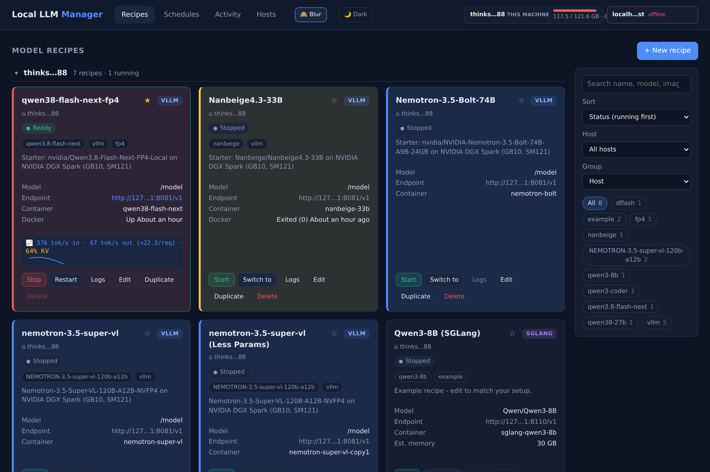
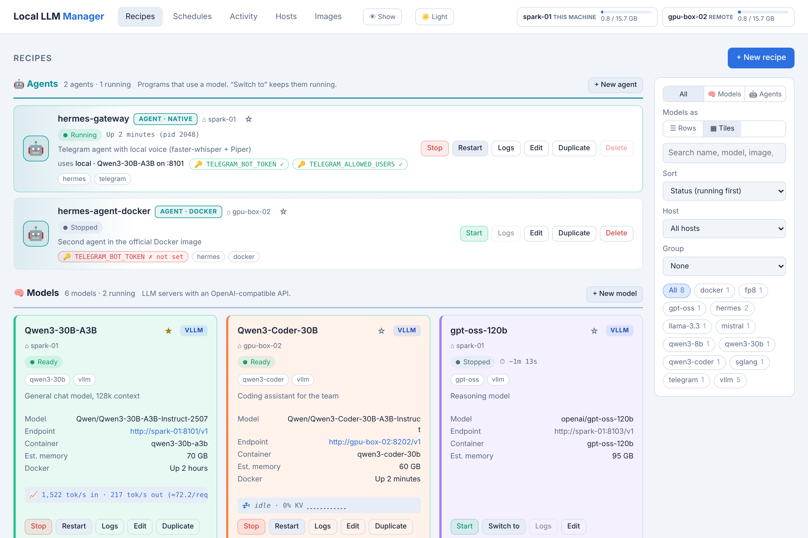
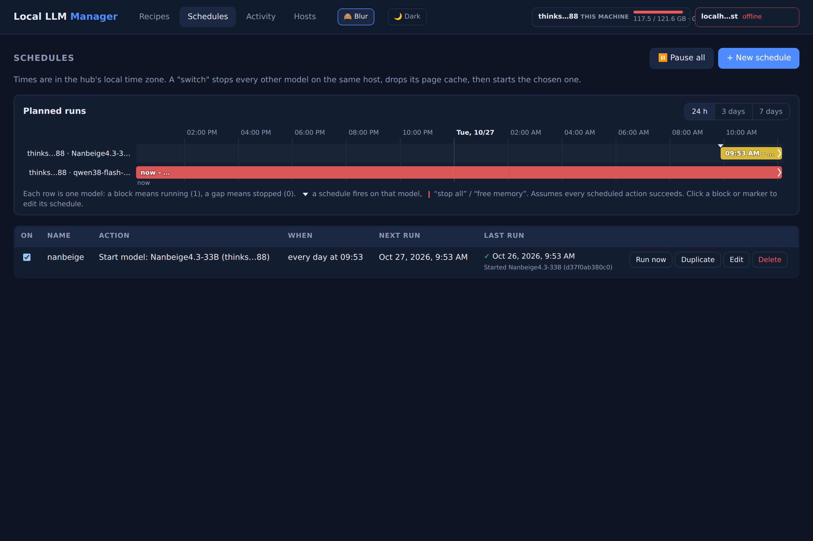
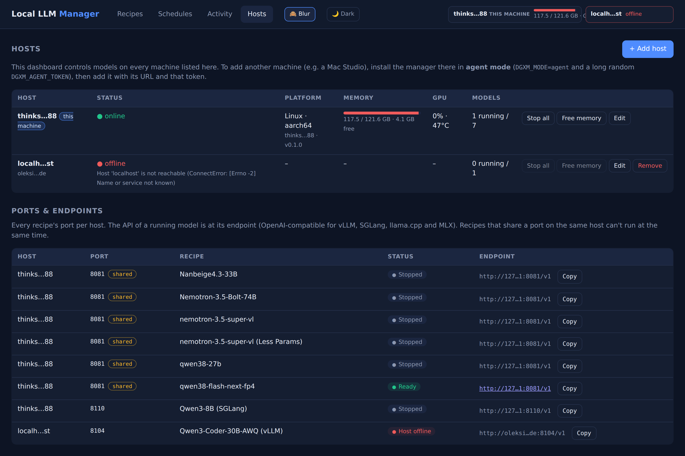
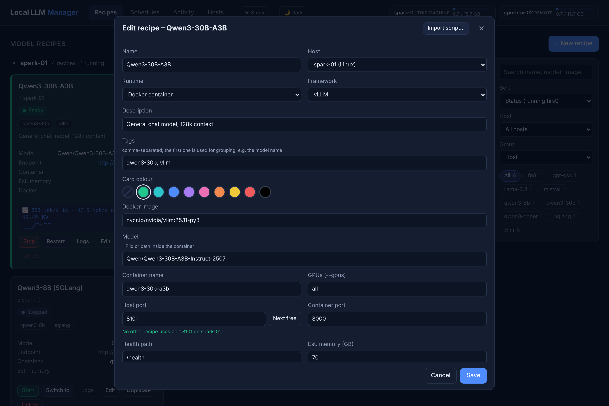

# Local LLM Manager

[](https://github.com/einfachllm/local-llm-manager/actions/workflows/ci.yml)
[](https://github.com/einfachllm/local-llm-manager/releases)
[](LICENSE)

A small web dashboard to run local LLMs on your own machines - an NVIDIA DGX Spark, a Mac with Apple
silicon, or any Linux box - from any browser on your network:



- **Recipes:** save how to start a model server (vLLM, SGLang, TensorRT-LLM, llama.cpp, MLX or any image),
  as a Docker container or as a native process. Or import an existing starter script / `docker run` command.
- **Start, stop, restart, or "switch to"** a model (stops the others on that machine and frees memory first).
- **Live status, logs and stats:** loading/ready/failed, tokens/s with a throughput sparkline, running
  requests, KV cache usage - and an estimate of how long a start typically takes (measured trigger → ready).
- **Schedules:** start, stop or switch models at set times, with a timeline of what will run when.
- **Several machines, one dashboard:** e.g. a DGX Spark and a Mac Studio side by side.
- **Screen-share friendly:** a blur toggle hides IP addresses and host names; dark, light and auto themes;
  ⭐ pinned recipes, collapsible groups and keyboard shortcuts (`?` shows them).

Model weights and Docker images must already be on the machine that runs them; the manager does not
download them.

## Screenshots

| Light theme | Schedules & planned-runs timeline |
|---|---|
|  |  |

| Hosts, ports & endpoints | Recipe editor |
|---|---|
|  |  |

The screenshots show a demo setup. The top-bar **🙈 Blur** toggle replaces host names and IPs with aliases such as
`host-3f2a` (as in the Hosts screenshot) - handy for screenshots and screen shares.

## Quick start

Requirements: Python 3.10+ and, for Docker recipes, Docker (with the NVIDIA runtime for GPUs) usable by
your user without `sudo`.

**Linux** (installs a systemd service running as your user):

```bash
git clone https://github.com/einfachllm/local-llm-manager.git
cd local-llm-manager
./install.sh
nano ~/.config/local-llm-manager.env      # set DGXM_PASSWORD
sudo systemctl restart local-llm-manager
```

**macOS** (installs a launchd agent; Docker on a Mac cannot use the GPU, so use native recipes such as
MLX - `pip install mlx-lm` - or `brew install llama.cpp`; also `brew install bash` for script import):

```bash
git clone https://github.com/einfachllm/local-llm-manager.git
cd local-llm-manager
./install-macos.sh     # creates .env on the first run
nano .env              # set DGXM_PASSWORD
./install-macos.sh     # run again to apply
```

**Docker Compose** (Linux, Docker recipes only):
`cp .env.example .env`, set `DGXM_PASSWORD`, then `docker compose up -d`. This uses the image
`ghcr.io/einfachllm/local-llm-manager:latest` (amd64 + arm64); add `--build` to build it yourself.

Then open `http://<machine>:8090` and log in as `admin` with your password.

## Upgrading

Your recipes, schedules and settings stay where they are (`data/manager.db` and your `.env`). Running
models keep running while the manager restarts.

```bash
cd local-llm-manager
git pull                  # or a release: git fetch --tags && git checkout v0.2.0
./install.sh              # Linux; on macOS: ./install-macos.sh
```

With Docker Compose: `docker compose pull && docker compose up -d`.

Upgrade the hub and all agents to the same version. Read the [CHANGELOG](CHANGELOG.md) before
upgrading, and copy `data/manager.db` first if you want to be able to go back.

## Several machines

One installation is the **hub**: it serves the dashboard and stores recipes, schedules and the activity
log. Every other machine runs the same app as an **agent** that only executes what the hub tells it to.

1. On the agent machine, add to its `.env` (`~/.config/local-llm-manager.env` on Linux) and (re)install:
   ```bash
   DGXM_MODE=agent
   DGXM_AGENT_TOKEN=<output of: openssl rand -hex 32>
   ```
2. In the hub's dashboard: **Hosts → Add host**, with the agent's URL (e.g. `http://mac-studio:8090`)
   and the same token. Recipes then get a **Host** field.

**Network access needed:**

| From | To | Why |
|---|---|---|
| Your browser | hub, port `8090` | The dashboard |
| Hub | each agent, port `8090` | Start/stop models, status, logs (plain HTTP + token) |
| Apps using a model | the machine running it, the recipe's port (e.g. `8100`) | The model's OpenAI-compatible API at `http://<machine>:<port>/v1` |

Agents never connect to the hub. All machines should be on the same local network or in the same
[Tailscale](https://tailscale.com) / WireGuard network; then use the agent's LAN or Tailscale name in its
URL. Do not expose these ports to the internet.

## Recipes in short

- Pick a **framework preset** (it fills in image, command, port and health check), then adjust the model,
  arguments, environment and volumes. The editor shows the exact `docker run` command.
- In the command, `{model}`, `{port}`, `{host_port}` and `{name}` are replaced. An environment line with
  only a name (e.g. `HF_TOKEN`) takes the value from the manager's own `.env`, so secrets stay out of
  recipes.
- **Native process** recipes run the command directly on the machine (needed for MLX on a Mac). Output
  goes to `data/processes/<name>.log`, and processes keep running if the manager restarts.
- **Import script…** fills a recipe from a starter script by running it with bash in a restricted mode
  that only records `docker run` / the server command and skips other commands. It is not a sandbox:
  *Check script* lists risky lines first - only import scripts you trust.
- Live stats come from the server's `/metrics` endpoint: on by default in vLLM, add `--enable-metrics`
  for SGLang and `--metrics` for llama.cpp.
- Starting is refused if the port is already in use on that machine.

## Schedules and time zone

A schedule repeats (weekdays + time, or a cron expression like `0 22 * * 1-5`) or runs once.
Actions: start, stop, restart, switch to a model, stop all models, stop all and free memory.

**All schedule times are in the hub's time zone**, not your browser's. The Schedules tab shows which
one it is, e.g. `CET (UTC+01:00)`. With `install.sh` / `install-macos.sh` that is the machine's system
time zone; the Docker Compose file mounts the host's `/etc/localtime` for the same result (without it, a
container runs in UTC). Change it with `sudo timedatectl set-timezone Europe/Berlin` on Linux, then
restart the manager.

If the hub was off when a repeating schedule was due, that run is skipped; a missed one-time schedule
still runs if it is less than 10 minutes late.

## Security

Anyone who can log in to the dashboard, or who knows an agent's token, can run any container or command
on those machines - effectively root. So: always set `DGXM_PASSWORD`, use a long random agent token, and
keep everything on a trusted network or VPN (or behind an HTTPS reverse proxy). Report vulnerabilities
as described in [SECURITY.md](SECURITY.md).

Built-in protections: the hub refuses to start with the example password `change-me`; requests that change
something are only accepted from the dashboard itself (other websites cannot use your browser's saved
login), and the dashboard cannot be embedded in other sites. Without a password it only answers when
opened by IP address or `localhost`. Behind a reverse proxy, pass the original host (`X-Forwarded-Host`).

## Configuration

Set in `.env` (or `~/.config/local-llm-manager.env` with `install.sh`):

| Variable | Default | |
|---|---|---|
| `DGXM_PASSWORD` / `DGXM_USER` | *(empty = no login, IP access only)* / `admin` | Dashboard login |
| `DGXM_PORT` / `DGXM_HOST` | `8090` / `0.0.0.0` | Listen address |
| `DGXM_MODE` | `hub` | `agent`: no dashboard, controlled by a hub |
| `DGXM_AGENT_TOKEN` | | Token the hub must send (required in agent mode) |
| `DGXM_DB` | `./data/manager.db` | SQLite database |
| `DGXM_STOP_TIMEOUT` | `30` | Seconds to wait on stop before killing |
| `DGXM_SEED` | `1` | Add two example recipes to an empty database |
| `HF_TOKEN`, … | | Passed to recipes that list the bare name in their environment |

Less common: `DGXM_HEALTH_HOST` (`127.0.0.1`), `DGXM_PROC_DIR` (`<db folder>/processes`),
`DGXM_DROP_CACHES_IMAGE` (`busybox:latest`).

Everything in the UI is also available as a JSON API; see `http://<machine>:8090/docs`.

## Contributing

Contributions are welcome! See [CONTRIBUTING.md](CONTRIBUTING.md) for the development setup, tests and
release process, and please follow the [Code of Conduct](CODE_OF_CONDUCT.md).

## License

Apache License 2.0 - see [LICENSE](LICENSE) and [NOTICE](NOTICE).
