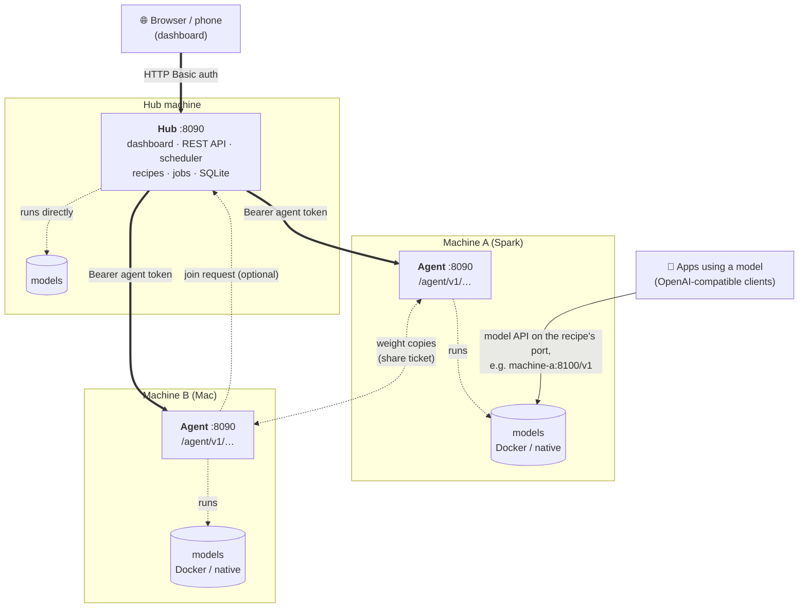
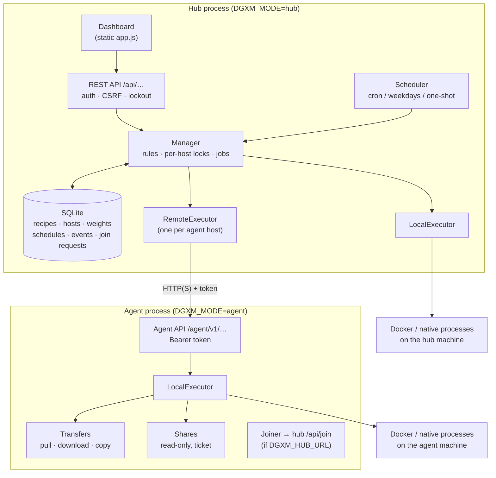
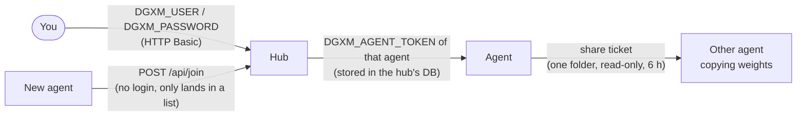
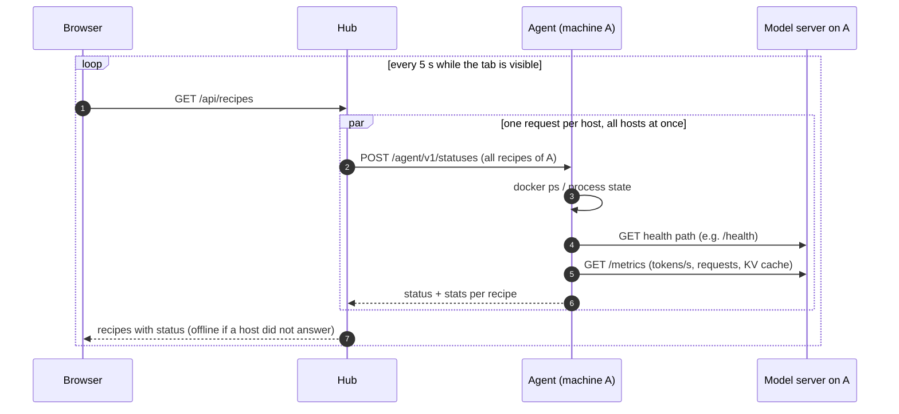
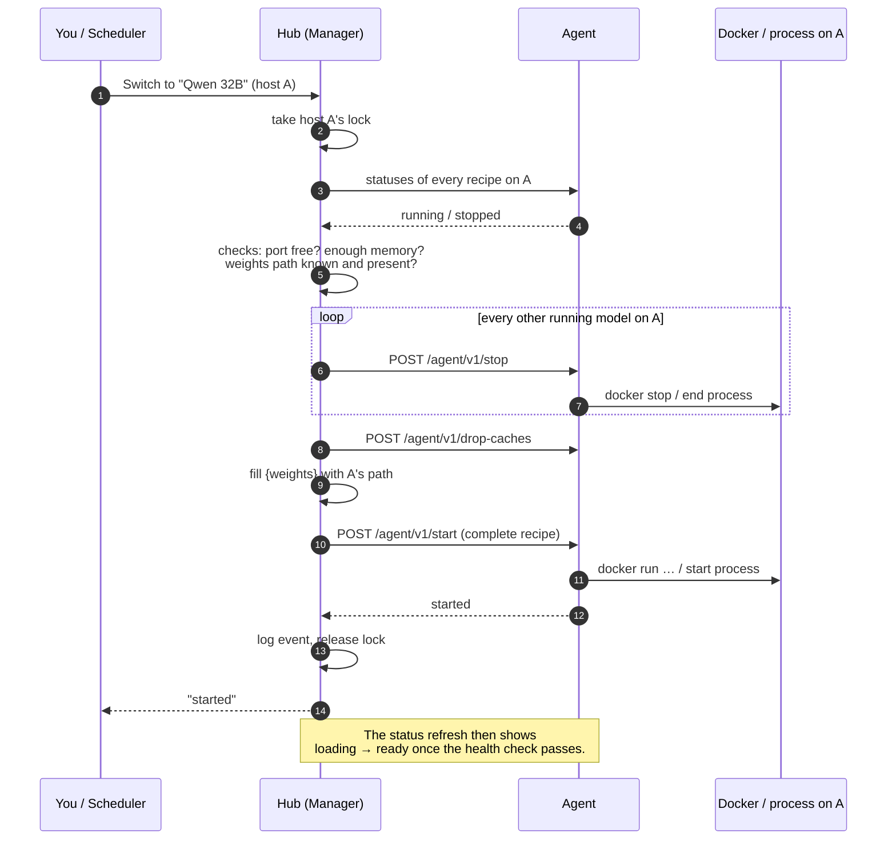
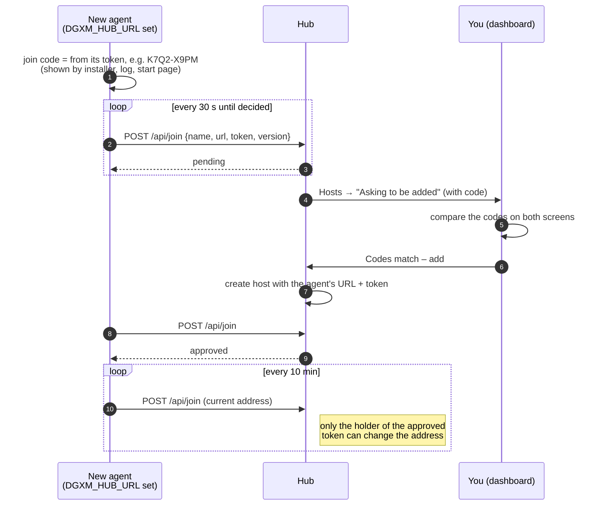
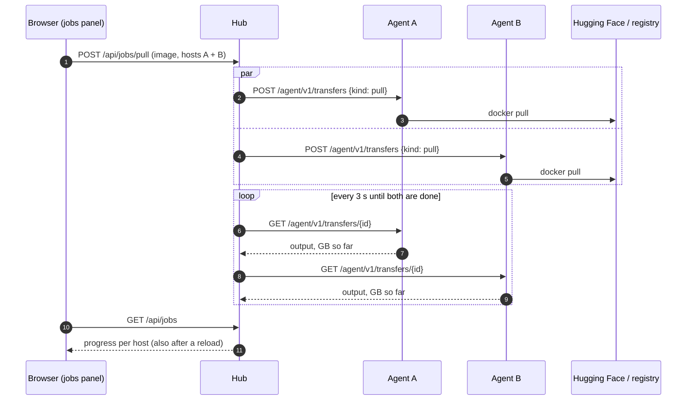
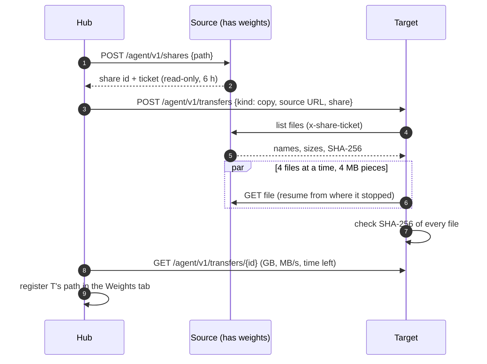
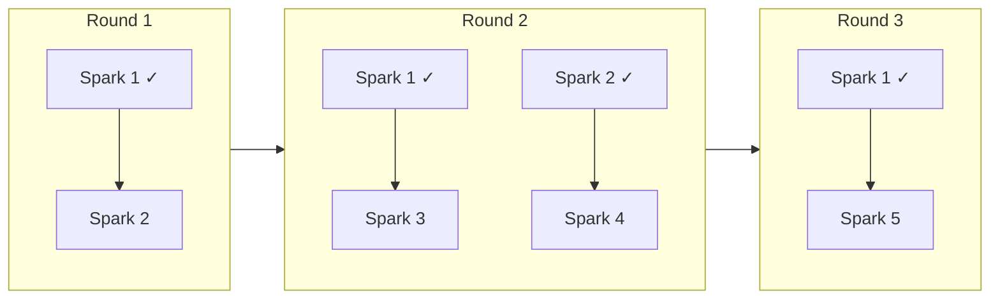
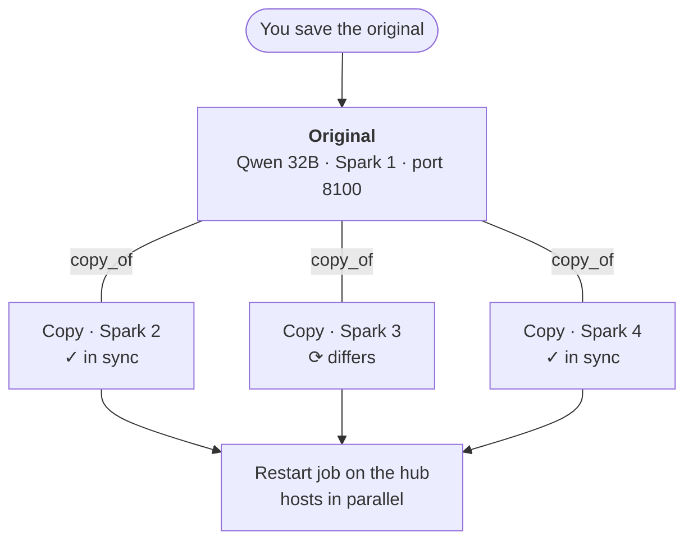

# Architecture

How the hub and the agents work together: who talks to whom, what each side stores and decides,
and what happens on the network when you start a model, add a machine or copy weights. This page is for
administrators; [How it works](how-it-works.md) explains the same in pictures, without the technical details.

!!! info "One app, two modes"
    The hub and the agents are the **same program**. `DGXM_MODE` picks the role: the default `hub` serves
    the dashboard and stores everything; `agent` only runs what a hub asks for and has no database, no
    dashboard and no scheduler. A hub controls its own machine directly, so a single machine needs no agent.

## The big picture

- **Solid lines** are the control path. Only the browser talks to the hub, and only the hub talks to the
  agents' API.
- **Dotted lines** are the exceptions: an agent with `DGXM_HUB_URL` *asks* the hub to add it, and machines
  copy weights *straight from each other* after the hub has arranged it.
- **Model traffic never passes through the manager.** Apps call the model server on its own port on the
  machine that runs it.

## Inside one process

| Part | Lives on | Does |
|---|---|---|
| **Manager** | hub | Owns the rules: port conflicts, memory check, weights check, what *Switch to* stops, the activity log, background jobs. Picks an executor per host. |
| **LocalExecutor** | hub and every agent | Does the actual work on *its own* machine: `docker run/stop`, native processes, logs, health checks, `/metrics`, transfers and shares. |
| **RemoteExecutor** | hub | The same interface as LocalExecutor, but every call becomes a request to an agent's `/agent/v1/…`. |
| **Scheduler** | hub | Fires schedules through the Manager, exactly like a click in the dashboard. Agents have no clock of their own. |
| **Database** | hub | Everything persistent. Agents keep only process state files, logs and a checksum cache. |

Because the hub's own machine and an agent go through the same executor interface, every feature works
the same on a single machine and on many.

## Who holds which key

- The **agent token** gives full control over models on that machine. Only the hub has it; it is never sent
  to the browser.
- A **share ticket** only allows listing and reading the files below one path, for 6 hours. The copying
  machine never sees the source's agent token, and no SSH is involved.
- A **join request** proves nothing on its own: it only appears under *Hosts → Asking to be added* until
  someone compares the join code and approves it.

## Status: what the 5-second refresh does

The hub asks each host **once** per refresh for all of its recipes, so many recipes on one machine
cost one request. A host that does not answer shows its recipes as *offline* without slowing the others.

## Starting or switching a model on an agent

- **The hub sends the complete recipe** with every start, so an agent needs no copy of recipes and a
  recipe moved to another host just works. `{weights}` becomes the path *on that host*.
- **One lock per host:** actions on the same machine (dashboard, scheduler, jobs) run one after another;
  a slow start on machine A (e.g. pulling a large image) does not hold up machine B.

## Adding a machine that asks to join

Rejected machines stay blocked for a week; requests nobody answers expire after an hour.

## Getting images and weights onto the machines

Pulls and downloads are **jobs**: the hub starts a task on each machine and then only asks how it is going.
The machines do the work themselves, so a hub restart or a closed browser does not interrupt them.

### Copying weights: host to host, like a snowball

Every machine that finishes becomes a source for the next one. With one machine that has the weights and
four that need them, the copy takes three rounds instead of four:

*Download on hosts* uses the same mechanism: the first ticked machine downloads from Hugging Face, and the
others copy from it, so the model comes over the internet only once.

## Copies of one recipe on several machines

When you save the original, the hub offers to update every copy and to restart the running ones. Copies are rows in the hub's database that point at their original (`copy_of`). They keep their own name,
container name, host and pin; everything else follows the original. Restarts after a sync run as a
background job: all hosts at the same time, one after another on the same host.

## Network ports

| From | To | Port | Encrypted? |
|---|---|---|---|
| Browser | hub | `8090` (`DGXM_PORT`) | with Tailscale or `tailscale serve` / a reverse proxy |
| Hub | each agent | `8090` | with Tailscale or an `https://` agent URL |
| Agent | hub (join only) | `8090` | as above |
| Agent | agent (weight copies) | `8090` | as above; the copy dialog warns about plain HTTP |
| Apps | model server | recipe port, e.g. `8100` | as the model server provides it |

The Hosts tab marks each host 🔒 Tailscale, 🔒 HTTPS or ⚠ plain HTTP. See
[Several machines → Tailscale](several-machines.md#recommended-tailscale) for the recommended setup.
