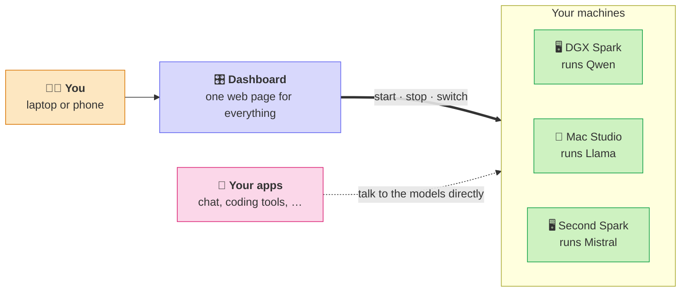
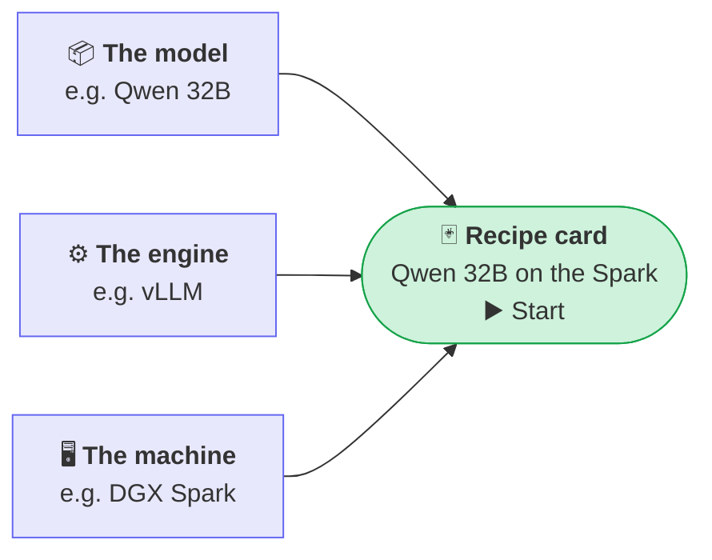
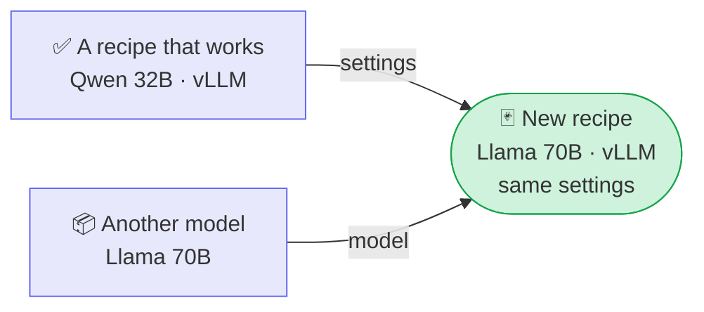
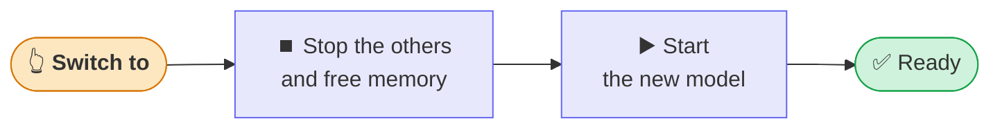
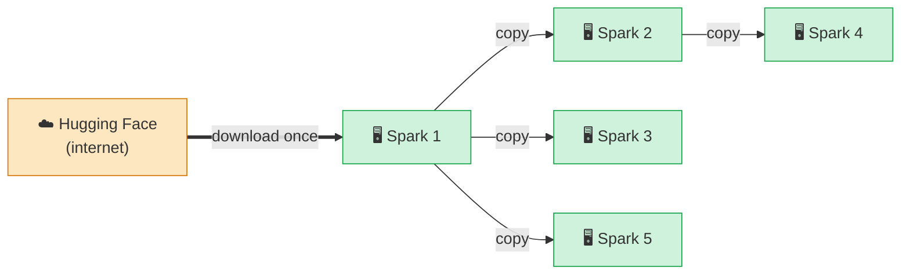
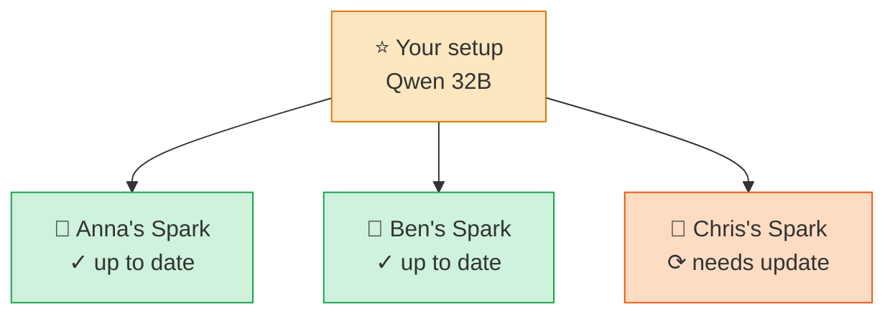

# How it works

Local LLM Manager is a remote control for the AI models on your own computers. You open one web page,
and from there you start, stop and switch models on every machine you have.

## The idea in one picture

- **The dashboard** is the one place where you control everything. It runs on one of your machines (the
  *hub*).
- **Every other machine** has a small helper installed (an *agent*) that does what the dashboard asks.
- **Your apps talk to the models directly.** The dashboard only switches models on and off. It never sees
  your chats.

!!! tip "Only one machine?"
    Then the dashboard and the models live on the same computer. You don't need anything else.

## Recipes: one card per model

A **recipe** is a saved start button for one model. You set it up once; after that, starting the model
is one click. Every recipe is made of three things:

You will soon have many recipes: one model in two sizes, the same model on several machines, a fast
model for coding and a big one for hard questions. That is fine. Each card is independent, and
**Switch to** makes sure only the right ones run.

!!! tip "Keep the list tidy"
    Pin the recipes you use daily, give cards a colour or tags (e.g. `coding`, `chat`), and use the host
    filter at the top to see one machine at a time.

### Which engine should I pick?

The *engine* (called **framework** in the recipe) is the program that runs the model. Several exist
because they suit different machines and model files. You don't need to know them all, just use the first row that fits:

| Your situation | Pick | Why |
|---|---|---|
| 🍎 A Mac with Apple silicon | **MLX** | Made for Apple chips |
| 📄 The model is one **.gguf** file | **llama.cpp** | Small and simple, made for GGUF |
| 👥 Several people or tools use the model at once | **vLLM** (or **SGLang**) | Fastest with many users at the same time |
| 👤 Just you, on a Linux / NVIDIA machine | **vLLM** or **llama.cpp** | Both are fine |

Everything else (**TensorFold**, **Custom**) is for special cases: a program not in the list, or a
start script you already have. **📋 Import** turns such a script into a recipe for you.

### The easy way: copy what already works

You rarely fill in a recipe by hand. **⚡ Quick recipe** takes a recipe that already runs and swaps in
another model. Everything else (engine, settings, port) stays the same:

On the same machine, the new recipe even gets the same port, so your apps don't need any change: just
**Switch to** the other model.

## Switching to another model

Most machines only have memory for one big model at a time. **Switch to** takes care of everything in one
click:

The card shows each step live. When it turns **Ready**, your apps can use the new model. You can close
the browser at any point: the machine carries on by itself.

!!! example "Let it happen on a schedule"
    *Coding model during the day, a big reasoning model at night*: under **Schedules** the dashboard
    switches for you at set times, even when nobody has it open.

## Adding a new machine

-   **1️⃣ Install**

    Install the manager on the new machine and tell it where the dashboard is.

-   **2️⃣ Compare the code**

    The machine shows a short code, e.g. **K7Q2-X9PM**. The dashboard shows a code too.

-   **3️⃣ Add it**

    Same code on both? Click **Codes match – add**. Done ✅

The code works like the pairing code of a Bluetooth headset. If the two codes are the same, it is really
your machine. If they differ, click **Reject**. The step by step guide is in
[Several machines](several-machines.md).

## Getting a model onto every machine

Models are big: often 20 to 200 GB. The manager downloads a model from the internet **once**, and then the
machines pass it on to each other over your own network, which is much faster.

Like a snowball, every machine that is finished helps the next one. Five machines are done in three
rounds instead of five. Every file is checked on arrival, an interrupted copy continues where it stopped,
and a progress panel shows how long it will take.

## One setup for the whole team

Example: everyone on the team has their own DGX Spark. Set the model up **once** and roll it out:

Everyone gets the same model at the same address. If you change the original later (a newer version,
other settings), the dashboard offers to update all copies and restart them.

## Is it safe?

-   🏠 **Stays at home**

    Everything runs on your own machines. Your prompts and answers never leave them.

-   🔑 **Password protected**

    The dashboard needs a password. Machines only obey the dashboard they were added to.

-   🔒 **Private network**

    With [Tailscale](several-machines.md#recommended-tailscale) all traffic is encrypted, and it also works
    from your phone when you are away.

-   ✅ **Checked copies**

    Every model file copied between machines is checked, so a broken download cannot start a model.

!!! info "Want the details?"
    The [Architecture](architecture.md) page shows the same things for administrators: which machine talks
    to which, ports, keys and every step on the network.
