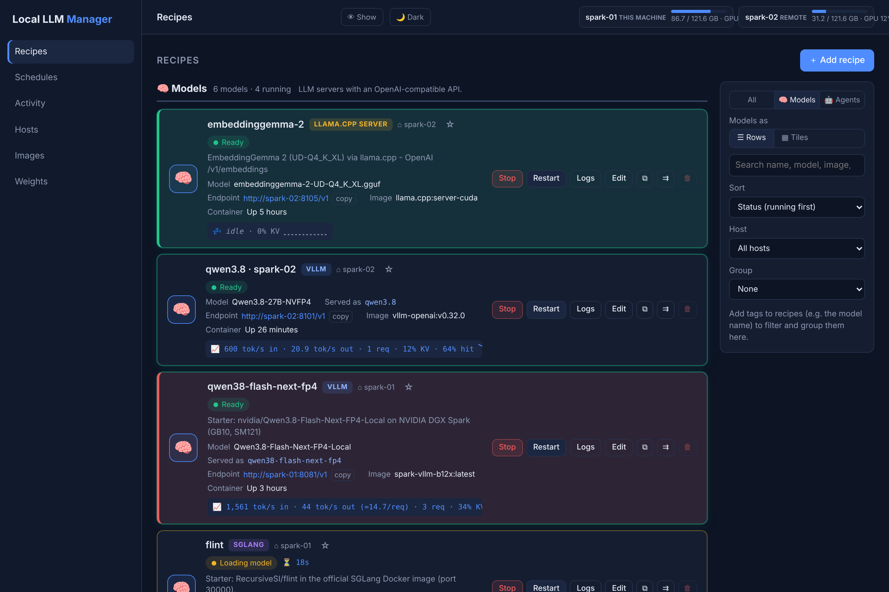

# Local LLM Manager

A small web dashboard to run local LLMs on your own machines – an NVIDIA DGX Spark, a Mac with Apple
silicon, or any Linux box – from any browser on your network.

## Who it is for

- **You want your best model recipes in one place**, across the broad inference engines - vLLM, SGLang,
  llama.cpp, MLX and TensorFold (experimental) - each one start-ready with a single click.
- **You don't want to deal with Docker or shell scripts:** paste one of the
  [example recipes](recipes.md#importable-example-recipes), download the model in the Weights tab, press
  **Start**.
- **You run LLMs on different machines** - a DGX Spark, a Mac, a Linux PC - and want one dashboard for all.
- **Some of your machines have little disk space:** see which model is where and how big it is, and copy
  models only to the machines that need them.

## What it does

- **All the broad inference engines.** vLLM, SGLang, llama.cpp, MLX and TensorFold (experimental) have
  presets; any other Docker image or native binary works as *Custom*. → [Recipes](recipes.md#supported-engines)
- **Recipes from YAML or a shell script.** Paste a short YAML recipe or the `docker run` / start script you
  already have into **＋ Add recipe** - no forms. Export any recipe as YAML and import it on another
  machine or another manager. → [Recipes](recipes.md)
- **Weights management.** One table shows which model is where on every machine. Download from Hugging
  Face once, then copy host to host over your network (SHA-256 checked, resumable). Recipes use
  `{weights}`, so they run on any host without edits. → [Weights](weights.md)
- **Hub and agents.** Start the hub, install agents on your other machines, and connect them with a token -
  or let them ask to join and approve them by comparing a join code. → [Several machines](several-machines.md)
- **Hosts at a glance.** A graph of the hub and every agent PC with memory, GPU and CPU temperature, what
  runs where, and live tokens/s, requests and KV-cache use per model.
  → [Several machines](several-machines.md#the-hosts-tab)
- **Start, stop, restart or "switch to"** a model - switching stops the other models on that machine and
  frees memory first - plus live status, logs and **schedules**.

## Where to start

-   **[Quick start](quick-start.md)**

    Install the manager on one machine, log in and start your first model.

-   **[Recipes](recipes.md)**

    Add recipes by pasting YAML or a script, and move them between machines and managers.

-   **[Weights](weights.md)**

    Find, download and copy model weights to every machine.

-   **[Several machines](several-machines.md)**

    Add more machines as agents and control them all from one dashboard.

-   **[How it works](how-it-works.md)**

    The idea in pictures: one dashboard, all your machines, models shared between them.

-   **[Configuration](configuration.md)**

    Every setting in `.env`, with defaults.

Settings are in the [Configuration](configuration.md) reference. Schedules, security, upgrading and
monitoring are in the [README on GitHub](https://github.com/einfachllm/local-llm-manager#readme) for now.
