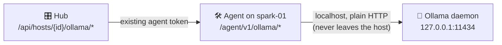
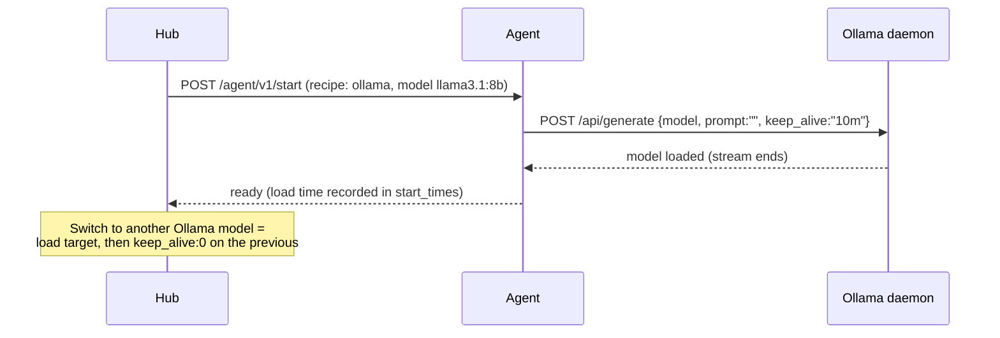

# Ollama integration (architecture proposal)

> **Status: proposal, not implemented.** This document describes *how* Ollama could fit into
> Local LLM Manager's hub/agent architecture. Nothing here changes behaviour until the phases
> below are built. It is maintainer documentation and is intentionally not in the mkdocs nav yet.

## Summary

Ollama is the one popular local-LLM stack that does not fit the manager's recipe model out of the
box: the manager assumes **one recipe = one model = one port** (a vLLM/SGLang/llama.cpp server
process or container that is started and stopped), while Ollama is **one daemon that serves many
models on one port** and loads/unloads them on demand.

This document proposes an integration in three phases:

1. **Phase 1 — Integration layer.** The agent discovers and talks to an existing Ollama daemon on
   its host. The hub shows installed models per host, can pull and delete them, and shows
   load state. No new recipe semantics.
2. **Phase 2 — Model cards.** Each Ollama model becomes a *card* (a "virtual recipe") whose
   Start = load into memory, Stop = unload, so **Switch to** and **Schedules** work unchanged.
3. **Phase 3 — optional.** Cross-host copies of Ollama models through the existing
   shares/transfer machinery.

Design principles carried over from the rest of the manager:

- **Control plane, not data path.** The manager loads/unloads and pulls models; inference clients
  keep talking to Ollama directly at `http://<host>:11434`. The manager never sees prompts.
- **The manager talks to an existing Ollama, it does not own Ollama storage.** Models stay in
  Ollama's own directories; the manager references them in place. The daemon itself stays
  user-managed (systemd service, Homebrew, or the user's own `docker run`) — reviewed decision:
  a dedicated daemon recipe is **not needed**; anyone who wants one can model it today with the
  existing *Custom (Docker)* / *Custom (native)* presets.
- **An empty or absent Ollama installation is a valid state**, not an error.
- **Ownership boundary.** The integration never stops or restarts a daemon it did not start
  itself; it only reports it. A daemon that is down is a health finding, not something to fix
  behind the user's back.

## Decision from review: no daemon recipe

An early draft proposed presets that run the Ollama daemon itself (`ollama/ollama` in Docker or
`ollama serve` natively) as manager-managed recipes. Decision: **not needed.** The daemon stays
user-managed; the integration talks to it in place, consistent with the ownership boundary above.
A *Custom (Docker)* recipe with image `ollama/ollama`, port `11434`, health path `/api/version`
and a `~/.ollama` volume already covers anyone who wants the manager to keep a daemon up —
no first-class preset is planned.

## Phase 1 — Integration layer

### Topology: agent talks to the daemon, hub talks to the agent

Ollama listens on `127.0.0.1:11434` on the machine it runs on. The agent already runs on that
machine and already holds the bearer-token API the hub calls. So all Ollama traffic is
**hub → agent → daemon (localhost)**:



Consequences:

- **The network-access table stays unchanged.** Ollama never has to be reachable from the hub;
  nothing new needs to be opened in Tailscale or a firewall.
- **No new SSRF surface.** The hub never fetches a user-supplied Ollama URL itself; the
  destination is decided by the agent's own configuration (see below).
- **No new secrets.** The Ollama REST API is unauthenticated by design; the agent token already
  guards every new endpoint.

### Daemon discovery and configuration

The agent resolves the daemon URL at request time, in this order:

1. **Explicit override:** `DGXM_OLLAMA_URL` in the agent's `.env` (e.g. a second daemon on
   another port, or a daemon in a container with `OLLAMA_HOST=0.0.0.0`).
2. **Probe `http://127.0.0.1:11434/api/version`** (native installs, and Docker recipes with
   `-p 11434:11434`).
3. **Probe `http://host.docker.internal:11434`** — the manager itself runs in a container under
   Docker Compose, where `127.0.0.1` is the *container*, not the host.
4. **None found** → Ollama section reports "not found on this host", which is a normal state,
   not a finding.

The result is cached per agent process with a short TTL (one successful probe re-probed at most
every ~60 s) so every dashboard poll does not hit the daemon.

The hub stores what each agent last reported (URL + version + reachable-at) in a new JSON column
so the Hosts view can render it without waking every agent.

### New agent endpoints

Added to `agent.py`, behind the existing `require_token` dependency, mirroring the existing
patterns (404 → "agent too old" on the hub side, like `images` / `models/check`):

| Endpoint | Delegates to | Ollama API used |
|---|---|---|
| `GET /agent/v1/ollama/status` | new `local_llm_manager/ollama.py` | `GET /api/version` → `{url, version, reachable}` |
| `GET /agent/v1/ollama/models` | same | `GET /api/tags` + `GET /api/ps` merged |
| `GET /agent/v1/ollama/models/{name}/show` | same | `POST /api/show` |
| `POST /agent/v1/ollama/pull` | transfer machinery (jobs) | `POST /api/pull` (stream) |
| `DELETE /agent/v1/ollama/models/{name}` | same | `DELETE /api/delete` |
| `POST /agent/v1/ollama/models/{name}/load` · `/unload` | *Phase 2* | `POST /api/generate` with `keep_alive` |

New module `local_llm_manager/ollama.py`: a thin `httpx` client over the Ollama REST API, roughly
`status() / models() / show() / pull_stream() / delete() / load() / unload()`. It contains all
Ollama-specific knowledge (URLs, JSON shapes, name:tag handling) so nothing else imports the
daemon's API surface.

**Pulls as transfers.** `POST /api/pull?stream=true` yields JSON lines with
`status / digest / total / completed` — the same progress shape the transfer machinery already
reports for image pulls and HF downloads. So `pull` becomes a new `kind` in
`LocalExecutor.start_transfer` / the `jobs` table: survives a hub restart, shows in the same
progress panel, is cancellable. The agent stops following the stream when the hub restarts; the
next `GET` of the job re-attaches (Ollama resumes pulling blobs itself).

**Deletion is explicit and confirmed.** `DELETE /api/delete` is destructive and cannot be undone;
the hub UI requires the same double-confirm pattern as weight deletion, and writes an `events`
row (activity log) on success and failure.

### What the model list shows

Merged from `/api/tags` (installed, with sizes) and `/api/ps` (currently loaded, with VRAM):

| Column | Source | Note |
|---|---|---|
| Name / tag | `tags.models[].name` (`llama3.1:8b`) | |
| Size on disk | `tags.models[].size` | |
| Quantization | `tags.models[].details.quantization_level` (`Q4_K_M`, …) | Also on the card in Phase 2 |
| Parameters | `tags.models[].details.parameter_size` (`7.6B`) | |
| Loaded now | `ps.models[].name` | Loaded = has a `ps` entry |
| VRAM in use | `ps.models[].size_vram` | Feeds `est_memory_gb` in Phase 2 |
| Modified | `tags.models[].modified_at` | |

This is also where the manager first shows GGUF quantization metadata for free — no blob
parsing needed, unlike generic Hugging Face folders.

### Health findings

New finding kinds in `health.py`, following the existing cause/fix/mute pattern:

| Finding | Trigger | Suggested fix text |
|---|---|---|
| Ollama daemon down | configured URL was reachable, now is not | "Start Ollama (or its recipe) on that machine" |
| Pull failed | transfer ended with an error / disk-full signature from the stream | free disk space; check `OLLAMA_MODELS` volume |
| Model load failed | Phase 2: preload returned an error (OOM is the usual cause) | free memory or switch to a smaller/quantized tag |
| VRAM pressure | Phase 2: sum of `ps.size_vram` near the GPU total from `system.snapshot()` | unload unused models (`keep_alive`) |

Muted for 24 h like every other finding; daemon-down also surfaces on the host card, next to the
engine/agent sections.

### Hub API and UI (Phase 1)

- `GET /api/hosts/{host_id}/ollama` → daemon status (cached last report + live probe).
- `GET /api/hosts/{host_id}/ollama/models`, `POST …/pull`, `DELETE …/models/{name}` → thin
  wrappers over `RemoteExecutor`, which fans out to agents exactly like `images`/`transfers` do.
- UI: an **Ollama section on the host card** (in the Hosts graph and in the host's detail view):
  daemon status badge, model table, pull dialog (name with tag suggestions), delete. A global
  "Models on all hosts" table can come later; per-host first keeps the diff small.
- Activity log: `pull`, `delete` events with host, model and result — same masking rules as
  other actions (nothing secret involved).

### Database changes (Phase 1)

Minimal — one migration in the existing `ALTER TABLE` list:

```sql
ALTER TABLE hosts ADD COLUMN services TEXT NOT NULL DEFAULT '{}';
-- {"ollama": {"url": "http://127.0.0.1:11434", "version": "0.6.2", "seen_at": "..."}}
```

No Ollama models are stored in the manager DB in Phase 1; the daemon is the source of truth, the
hub just caches the last report. This keeps the "manager does not own Ollama storage" principle
literal.

## Phase 2 — Model cards (per-model Start/Stop/Switch)

### The problem to solve

Recipe semantics assume exclusive ownership of a port and a process/container:

- **Port conflict check** refuses to start when the host port is busy — but many Ollama model
  cards *intentionally* share the daemon's port.
- **Start** means `docker run`/spawn — but for an Ollama model it means *load into the running
  daemon* (`POST /api/generate` with `keep_alive`), which fails if the daemon is not running.
- **Stop** kills a container/process — for an Ollama model it means *unload* (`keep_alive: 0`).
- **Statuses** come from `docker inspect`/process checks — here they come from `GET /api/ps`.

### Design: virtual recipes with a shared-port flag

A model card is a real `recipes` row (so schedules, pins, tags, copies and the activity log all
work unchanged) with:

- `framework = "ollama"`, `host_id` set, `model = "llama3.1:8b"` (name:tag)
- `host_port = container_port = 11434` (the daemon's port)
- a new `shared_port INTEGER NOT NULL DEFAULT 0` column: the port-conflict check treats
  `shared_port` recipes as compatible with each other instead of conflicting; starting one does
  not fight the others. An *ordinary* recipe may still not take port 11434.
- no container/process of its own — `LocalExecutor.statuses` resolves `ollama` recipes from
  `GET /api/ps` (loaded ⇒ running, absent ⇒ stopped) instead of Docker.

Start / stop / switch map to daemon calls:



- **Start = load.** An empty `/api/generate` preloads the model and returns when weights are in
  memory; the measured duration lands in `start_times`, so the existing "typically takes X"
  estimate works.
- **Stop = unload** (`keep_alive: 0`), not daemon shutdown — the daemon keeps serving other
  models. The daemon's own service manager stops the daemon itself.
- **Switch to** on an Ollama host: load the target, then unload the other *loaded* Ollama models
  on that host. Plain (vLLM/llama.cpp) recipes on the same host behave exactly as today —
  Switch never touches a daemon it did not start.
- **Schedules** work because they call the same start/stop paths — "load the coding model at
  09:00, the reasoning model at 22:00" is a normal schedule.
- **Live stats:** tokens/s, request counts and KV-cache are **not available** — Ollama exposes no
  metrics endpoint and the manager stays out of the data path by design. The card shows what the
  daemon offers: loaded/unloaded, VRAM from `/api/ps`, quantization and parameters from
  `/api/show`, and the load-time estimate. This is an accepted, documented limitation, consistent
  with how llama.cpp-without-`--metrics` behaves today.
- **OpenAI endpoint:** apps talk to `http://<host>:11434/v1` (Ollama's built-in OpenAI
  compatibility). The Ports & endpoints list shows it like any other model endpoint.

### Ownership and failure modes

- Cards depend on a *running daemon*. If the daemon is down, model cards show **stopped** with a one-line hint pointing at the daemon, not a failed
  load loop. Loading is attempted only when the daemon is reachable.
- `keep_alive` default: use Ollama's own (`OLLAMA_KEEP_ALIVE`, typically 5 m) and let an explicit
  recipe env override it; the manager does not invent its own eviction policy.
- Native daemon vs. container daemon are indistinguishable to model cards — by design. The card
  targets `host:port`, not an install method.
- Version skew: agents older than Phase 1 answer 404 on `/agent/v1/ollama/*`; the hub shows
  "update the agent on <host>" — the exact pattern `RemoteExecutor` already uses for `images`.

## Phase 3 (optional) — Cross-host copies of Ollama models

An Ollama model is two directories under `OLLAMA_MODELS` (default `~/.ollama/models`):

- `blobs/` — content-addressed GGUF chunks (`sha256-…`, no extension)
- `manifests/` — tag → blob references

Both are plain files, so the existing **shares** (read-only file share + ticket) plus the copy
transfer machinery could sync them host-to-host: share the models dir, copy `blobs/` +
`manifests/` (SHA-256 checked by blob name for free), then the target Ollama lists the model
after its next `GET /api/tags` — no conversion step.

Caveats that keep this optional and last:

- ownership: on Linux the daemon often runs as the `ollama` service user; the copied files must
  end up readable/writable by it (the agent would `chown` where permitted, else warn);
- partial blobs from an interrupted pull must be excluded (skip in-flight digests);
- different `OLLAMA_MODELS` paths per host are fine — the copy is root-dir-relative.

An alternative "download a GGUF and run it with llama.cpp" path already exists: Ollama blobs are
plain GGUF files, so a *Run with llama.cpp* offer on a model card (mounting the blob read-only)
needs no new transfer at all. That is cheap and covers the "this model exists only in Ollama on
one machine" case without Phase 3.

## Security review

| Concern | Assessment |
|---|---|
| New network paths | None outward. Agent → daemon is localhost-only; hub → agent uses the existing token. |
| SSRF | Hub never fetches user-supplied daemon URLs. The agent's `DGXM_OLLAMA_URL` is host-local configuration, same trust level as `DGXM_DOCKER`. |
| Auth surface | New agent endpoints sit behind the existing bearer token; the hub endpoints behind the dashboard login + same-origin mutation guard. |
| Secrets | None introduced. Ollama's API is unauthenticated by design; the daemon must not be exposed beyond the host — same guidance as the model ports themselves. |
| Destructive actions | Model delete is double-confirmed and logged; unload affects only memory residency, not data. Pull writes only into Ollama's own storage. |
| Docker authority | No new mounts. Ollama storage is touched only through the daemon API; Phase 3 copies go through shares, not mounts. |

## Test plan (maps to the existing suite)

| Test file | Covers |
|---|---|
| `tests/test_ollama.py` (new) | `ollama.py` client against a fake daemon (httpx mock transport, as elsewhere): tags/ps merge, pull stream → progress, error shapes, offline daemon |
| `tests/test_agents.py` | new `/agent/v1/ollama/*` endpoints: token required, 404 shape, pull → transfer job |
| `tests/test_api.py` | hub fan-out via `RemoteExecutor`, "agent too old" path, host `services` column |
| `tests/test_executor.py` / `test_processes.py` | `shared_port` conflict rules; statuses of `ollama` recipes from `ps`; load/unload start/stop |
| `tests/test_scheduler.py` | schedule "switch between two Ollama models" |
| `tests/test_health.py` | new findings and their mute windows |
| `tests/test_security.py` | hub never dereferences agent-supplied URLs; shared_port recipes cannot shadow a normal recipe's port |

## Documentation to update when shipped

- `README.md`: Highlights (Ollama section), engine table, `.env` reference (`DGXM_OLLAMA_URL`).
- `docs/how-it-works.md`: "Which engine should I pick?" row for Ollama.
- New user page `docs/ollama.md` (this file gets replaced by a feature doc); add to `mkdocs.yml` nav.
- `docs/configuration.md`, `CHANGELOG.md`.

## Open questions

1. **One daemon per host** is assumed. Supporting several (different ports) only needs the
   `DGXM_OLLAMA_URL` override + a per-daemon key in `hosts.services` — defer until someone asks?
2. Should Phase 2 cards also appear in the Weights tab (as read-only entries whose path is the
   Ollama models dir), or stay fully in the Ollama section?
3. For **HF-pull fallback** (a model exists on HF but not in Ollama): use `hf pull` into a model
   dir and a llama.cpp recipe, or Ollama's own `ollama pull hf.co/{repo}`? The latter keeps
   everything inside the daemon; the former keeps manager-native weights. Suggest: offer
   `ollama pull hf.co/…` in the pull dialog, nothing more.
4. Naming of the per-model `framework`: `"ollama"` = model card. No daemon presets are planned
   (the daemon stays user-managed), so there is no name collision in `FRAMEWORKS`.
