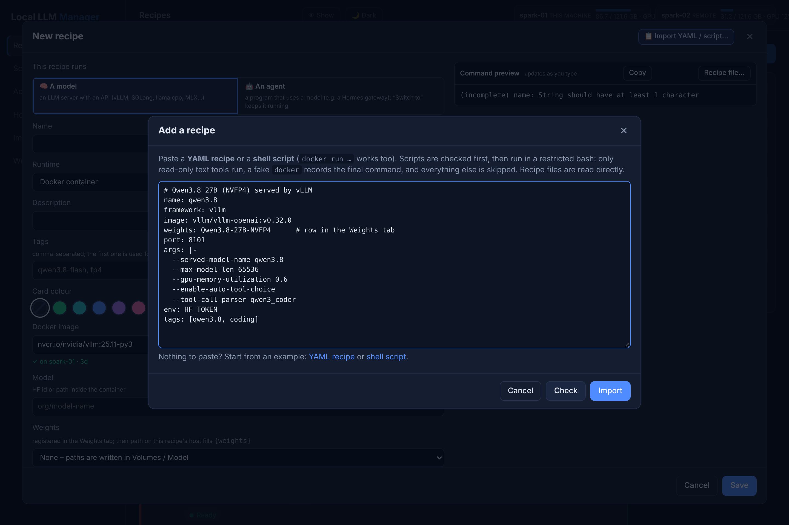
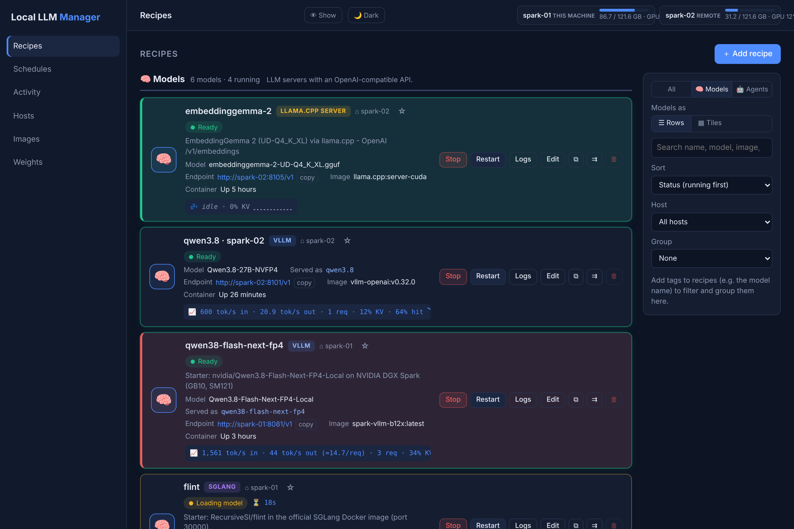

# Quick start

This page sets up the manager on one machine and starts a first model. For more machines, continue with
[Several machines](several-machines.md) afterwards.

## Requirements

- Python 3.10 or newer.
- For Docker recipes: Docker, usable by your user without `sudo`, with the NVIDIA container runtime for
  GPUs.
- Disk space for the model weights. The manager can pull Docker images and download weights from Hugging
  Face for you ([Weights](weights.md)), or you put them on the machine yourself.

## 1. Install

=== "Linux"

    Installs a systemd service that runs as your user.

    ```bash
    git clone https://github.com/einfachllm/local-llm-manager.git
    cd local-llm-manager
    ./install.sh
    ```

    The installer prints a generated password and stores it in `.env` in this folder.

=== "macOS"

    Installs a launchd agent. Docker on a Mac cannot use the GPU, so use native recipes (framework
    *Custom (native)*) with e.g. MLX (`pip install mlx-lm`) or llama.cpp (`brew install llama.cpp`). For importing start scripts, also
    run `brew install bash`.

    ```bash
    git clone https://github.com/einfachllm/local-llm-manager.git
    cd local-llm-manager
    ./install-macos.sh
    ```

    The installer prints a generated password and stores it in `.env`.

=== "Docker Compose"

    Linux only, and only for Docker recipes. Uses the image `ghcr.io/einfachllm/local-llm-manager:latest`
    (amd64 and arm64).

    ```bash
    git clone https://github.com/einfachllm/local-llm-manager.git
    cd local-llm-manager
    cp .env.example .env
    ```

    Set `DGXM_PASSWORD` in `.env` (at least 12 characters, e.g. from `openssl rand -base64 18`), then:

    ```bash
    docker compose up -d
    ```

    Add `--build` to build the image yourself.

## 2. Log in

Open `http://<machine>:8090` in a browser and log in as **admin** with the password from the installer
(or the one you set in `.env`).

To change the password, edit `DGXM_PASSWORD` in `.env` (at least 12 characters, no well-known passwords)
and restart the service.

## 3. Start your first model

1. Click **＋ Add recipe** (shortcut `i`).
2. Paste a **YAML recipe** or a **shell script** / `docker run` command - or click **YAML recipe** or
   **shell script** under the box for an example to edit. A YAML recipe only lists what differs from the
   engine's defaults:

    ```yaml
    name: qwen3-8b
    framework: vllm          # vllm, sglang, llamacpp, mlx, …
    model: Qwen/Qwen3-8B     # a Hugging Face id, or  weights: <name in the Weights tab>
    port: 8101
    ```

    Scripts are checked for risky calls first; nothing in them is executed.
    

3. **Import**, check the fields and the command preview, then **Save**.
4. Click **Start** on the new card. The status goes from *starting* to *loading* to *ready*, and a running
   model shows its live speed, requests and KV-cache use:

    

A second model with the same settings: **⧉ Duplicate** on the card, then change the model. In the editor,
**Recipe file…** exports a recipe as YAML.

When the model is ready, its OpenAI-compatible API is at the endpoint shown on the card:

```bash
curl http://<machine>:<port>/v1/models
```

## Next steps

- Get model weights onto the machine (download, or register what is already there): [Weights](weights.md).
- Move recipes between machines or managers, and the example recipes: [Recipes](recipes.md).
- Run models on more than one machine: [Several machines](several-machines.md).
- Upgrading, uninstalling, schedules and all settings are described in the
  [README](https://github.com/einfachllm/local-llm-manager#readme).
