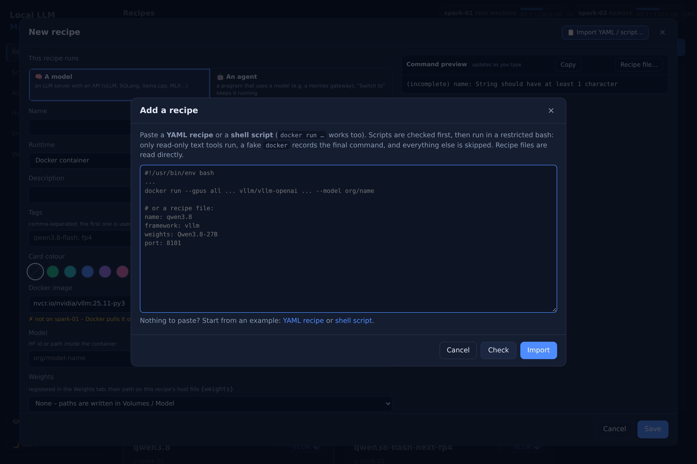
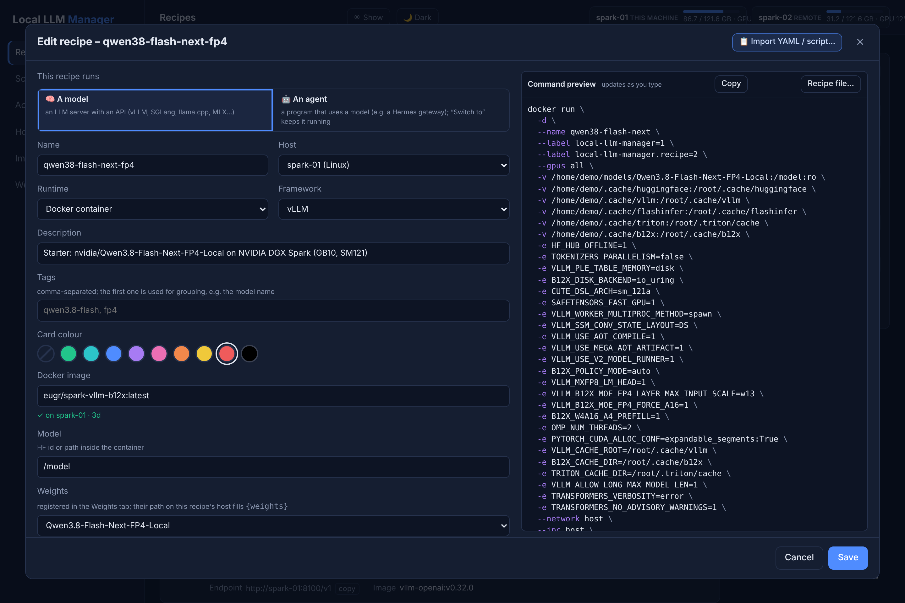

# Recipes

Recipes save how to start a model server (vLLM, SGLang, llama.cpp, MLX, TensorFold or any image / native binary) as a Docker container or a native process. You can also import an existing start script, `docker run` command or compact JSON/YAML recipe file, and export any recipe the same way.

## Supported engines

Every recipe names a `framework:`. The preset fills in the image, start command, container port and health
check, so a recipe only writes down what differs from it.

| `framework:` | Engine | Runs as | Default image / command | Good for |
|---|---|---|---|---|
| `vllm` | vLLM | Docker | `nvcr.io/nvidia/vllm:25.11-py3`, `vllm serve` | NVIDIA GPUs, DGX Spark, high throughput |
| `sglang` | SGLang | Docker | `lmsysorg/sglang:spark`, `python3 -m sglang.launch_server` | NVIDIA GPUs, models that ship SGLang support first |
| `llamacpp` | llama.cpp server | Docker | `ghcr.io/ggml-org/llama.cpp:server-cuda` | `.gguf` files, smaller GPUs |
| `llamacpp-native` | llama.cpp server | native process | `llama-server` | `.gguf` on a Mac or without Docker |
| `mlx` | MLX | native process | `mlx_lm.server` | Macs with Apple silicon |
| `tensorfold` | TensorFold *(experimental)* | native process, or Docker when the recipe brings its own `image:` and `command:` | `tensorfold serve` | trying TensorFold; a starter image that ships the engine |
| `custom` / `process-custom` | anything else | Docker / native process | your image or binary | other servers, agents such as a Hermes gateway |

vLLM, SGLang, llama.cpp and MLX all serve an OpenAI-compatible API at `http://<host>:<port>/v1`, so your
apps don't care which engine runs behind the endpoint. Live stats (tokens/s, requests, KV cache) come from
the server's `/metrics`: on by default in vLLM and TensorFold, add `--enable-metrics` for SGLang and
`--metrics` for llama.cpp.

## Add a recipe: paste YAML or a shell script

There is no form to fill in. Click **＋ Add recipe** (shortcut `i`) and paste one of:

=== "YAML recipe"

    Only what differs from the engine's defaults - the framework preset fills in the rest:

    ```yaml
    name: qwen3-8b
    framework: vllm          # vllm, sglang, llamacpp, mlx, tensorfold, custom, …
    model: Qwen/Qwen3-8B     # a Hugging Face id - or  weights: <row in the Weights tab>
    port: 8101
    args: --max-model-len 32768 --gpu-memory-utilization 0.8
    ```

=== "Shell script / docker run"

    The start script you already use - a plain `docker run …`, or a script that computes values first:

    ```bash
    #!/usr/bin/env bash
    # Flint served by SGLang      <- the first comment line becomes the description
    docker run -d --gpus all -p 30000:30000 \
      -v ~/.cache/huggingface:/root/.cache/huggingface \
      lmsysorg/sglang:spark \
      python3 -m sglang.launch_server --model-path RecursiveSI/flint --port 30000
    ```

    The script is checked for risky lines first, then run with bash in a restricted mode in which only a
    fake `docker` (that records the command) and read-only text tools really run. Nothing is started.



Under the box, **YAML recipe** and **shell script** insert an example of each to edit. After **Import**
the editor opens with every field filled and the exact `docker run` command beside it; check name, port
and paths, then **Save**. For a variant of a recipe that already works, use **⧉ Duplicate** on its card.



## Move recipes between machines and managers

A recipe is not tied to the machine it was written on:

| You want to… | Do this |
|---|---|
| Run it on **another host of the same dashboard** | Change its **Host** field. With `{weights}` the model folder follows: each host mounts its own path from the [Weights](weights.md) tab. |
| Run it on **several hosts at once** and keep them equal | **⇉** on the card copies it to the hosts you tick; later changes to the original are offered to all copies, which can be restarted together. See [Several machines](several-machines.md#the-same-recipe-on-several-machines). |
| Take it to **another installation** (a colleague's hub, a test instance) or into Git | In the editor, **Recipe file…** shows the recipe as compact YAML or JSON - **Copy** or **Download** it, and paste it into **＋ Add recipe** on the other manager. |
| Tweak a recipe as text | Edit the YAML in **Recipe file…** and press **Apply to editor**; nothing is saved until you click **Save**. |

The recipe file contains everything the container needs - image, model, ports, arguments, environment
names, volumes and extra Docker flags - but **no secret values**: a bare `HF_TOKEN` line is filled from
the `.env` of the machine that runs it. Use `weights:` instead of fixed paths, and the same file works on
every machine that has the model.

## Importable example recipes

Ready-made recipes you paste into the manager instead of typing fields: click **＋ Add recipe**, paste a whole file from [`examples/recipes`](https://github.com/einfachllm/local-llm-manager/tree/main/examples/recipes), review the draft (name, port, paths) and create.

Two formats are accepted:

- **`.yaml` / `.json` - compact recipe files.** The manager's own fields: image, model, ports, `args`, `env`, `volumes`, `docker_args`, command, health path, tags. Missing settings come from the framework preset, so only what differs is written down. `weights:` names a registered Weights-tab entry (its per-host path fills `{weights}`); omit `model:` for the usual `/model` mount, or set it to another path. `host_port:` is the port on the host (`port:` is shorthand for it). `args`, `env`, `volumes` and `docker_args` can be multi-line strings or lists.
- **`.sh` - starter scripts / `docker run` commands.** The manager checks the script, runs it with bash in a restricted mode and turns the captured `docker run` into the same fields.

The current examples:

| File | Engine | What it is |
|---|---|---|
| [`qwen38-27b.yaml`](https://github.com/einfachllm/local-llm-manager/blob/main/examples/recipes/qwen38-27b.yaml) | vLLM | Qwen3.8 27B with MTP - the small compact recipe, and the one a fresh install starts with. |
| [`qwen38-dflash.yaml`](https://github.com/einfachllm/local-llm-manager/blob/main/examples/recipes/qwen38-dflash.yaml) | vLLM | Qwen3.8-27B-NVFP4 with the DFlash2 drafter: speculative decoding, model and drafter from one registered folder. |
| [`qwen38-dflash-docker.sh`](https://github.com/einfachllm/local-llm-manager/blob/main/examples/recipes/qwen38-dflash-docker.sh) | vLLM | The same recipe as a **starter script**: a plain `docker run`, and the fields the manager reads out of it. |
| [`qwen38-sglang.yaml`](https://github.com/einfachllm/local-llm-manager/blob/main/examples/recipes/qwen38-sglang.yaml) | SGLang | The same model and drafter on SGLang's official image, **same port** - **Switch to** swaps the engine. |
| [`qwen38-tensorfold.yaml`](https://github.com/einfachllm/local-llm-manager/blob/main/examples/recipes/qwen38-tensorfold.yaml) | TensorFold | The same model and drafter served natively (no Docker) by TensorFold's CUDA engine on a DGX Spark. |
| [`qwen38-flash-next-fp4.yaml`](https://github.com/einfachllm/local-llm-manager/blob/main/examples/recipes/qwen38-flash-next-fp4.yaml) | vLLM | Qwen3.8-Flash-Next-FP4 on an NVIDIA DGX Spark (GB10, SM121): b12x image, tuned flags, caches, tool calling. |
| [`qwen38-flash-next-tensorfold.yaml`](https://github.com/einfachllm/local-llm-manager/blob/main/examples/recipes/qwen38-flash-next-tensorfold.yaml) | TensorFold | The same Flash-Next weights on TensorFold's Zig engine in MiaAI-Lab's starter image: 262k window, 5 streams, fp8 KV, MTP drafts, image and video in. |
| [`nemotron-3.5-super-vl.yaml`](https://github.com/einfachllm/local-llm-manager/blob/main/examples/recipes/nemotron-3.5-super-vl.yaml) | vLLM | Nemotron-3.5-Super-VL with a draft model for speculative decoding; both models sit in one registered folder. |
| [`hermes-agent-docker.yaml`](https://github.com/einfachllm/local-llm-manager/blob/main/examples/recipes/hermes-agent-docker.yaml) | - | A Hermes Agent gateway as an agent recipe: its own port and data volume, no model or GPU. |

The four Qwen3.8-27B recipes (`qwen38-27b`, `qwen38-dflash`, `qwen38-sglang`, `qwen38-tensorfold`) are the
same model on four engines: they share port **8101** and the served name `qwen3.8`, so one endpoint
`http://<host>:8101/v1` keeps working while you switch (`qwen38-dflash-docker.sh` is the second one again,
as a starter script). The three with a drafter mount one registered folder - the folder holding model and
drafter - which is how the two stay together on every host. The two `qwen38-flash-next-*` recipes are one
model on two engines as well: same weights entry, different image and port.

## Before you start

- **Weights:** compact recipes name a registered entry (`weights:`). Create it in the **Weights** tab with the folder on each host that runs the recipe, or change the name in the file. If a main model and a draft model share a folder, register that folder once, mount it, and point `model:` at the subfolder (see `nemotron-3.5-super-vl.yaml`). Starter scripts mount a concrete folder; download the model there, or point the volume at your copy. The **Weights** tab finds model folders under `DGXM_MODEL_DIR` by itself and offers them under "Found on your hosts".
- **Ports:** the port in `host_port:` / `port:` / `--port` becomes the recipe's port. Keep it the **same across models** you want to switch between, and give each `--served-model-name` a stable short name - then **Switch to** changes the model and your agents keep the same endpoint `http://<host>:<port>/v1`.
- **Secrets:** files list only bare names (e.g. `HF_TOKEN`); put the values in the manager's `.env` (see [Configuration](configuration.md)).
- **vLLM images:** the preset command starts with `vllm serve`. For `vllm/vllm-openai` (whose entrypoint already runs `vllm serve`), the manager drops the duplicate; images with a plain `vllm` entrypoint keep `serve`. The preview shows the actual command.
- Recipes are a starting point: the flags are tuned for the machine they ran on. Check `--gpu-memory-utilization`, `--max-model-len` and `--max-num-seqs` against your GPU's memory.

## Recipe list, filters and pinned recipes

The recipe list shows larger cards for quicker scanning. Use the top toolbar to:

- **Search** across name, model, host, image and tag.
- **Filter by engine** (vLLM, SGLang, llama.cpp, MLX, TensorFold, Custom – derived automatically from your recipes).
- **Filter by kind** (Models or Agents), by host and by tag.
- **Sort** by name, status or port.

Pinned recipes (★) appear in a dedicated “Pinned (always on top)” section at the top of the list. Blur and theme toggles live in the left sidebar.

More of your own? Drop new `.yaml` / `.json` files in `examples/recipes` and add a row to its table - or export one from the editor with **Recipe file…**.
