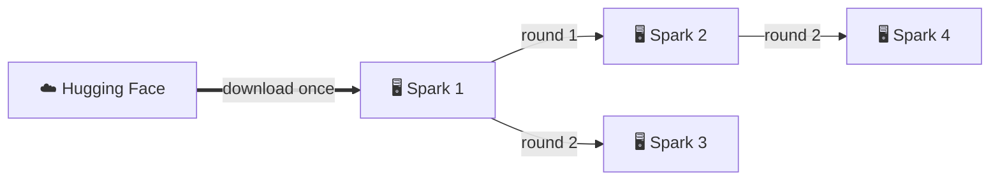

# Weights

Model weights are big (often 20-200 GB) and must be on the machine that runs the model. The **Weights**
tab keeps track of where each model is on each machine, finds weights that are already there, downloads
new ones from Hugging Face and copies them from machine to machine over your own network.


## One row per model, one column per host

The tab is a table: one row per model, one column per host.

| Cell | Meaning |
|---|---|
| **✓** `~/models/Qwen3.8-27B-NVFP4` 23.4 GB | The weights are at that path on that host. |
| **✗** | A path is set, but nothing is there (deleted, other disk not mounted, …). |
| **+ set path** | You have not said yet where the model is on that host. |

Click a cell to change the path. The same model is often in a different folder on each machine
(`~/models/Nemotron-VL` on one Spark, `/mnt/nvme/nemotron-vl` on another) - that is fine, each host keeps
its own path. `~` is the home directory of the machine that runs the recipe.

## Use weights in a recipe

In the recipe editor, pick the model under **Weights** and write `{weights}` where the path goes - picking
an entry adds the usual volume `{weights}:/model:ro` for you; in native recipes `{weights}` is the model
argument itself. In a YAML recipe the same is one line:

```yaml
name: qwen3.8
framework: vllm
weights: Qwen3.8-27B-NVFP4   # the row's name in the Weights tab
port: 8101
```

When the recipe starts, `{weights}` becomes the path of the host it runs on. So **moving a recipe to another
host, or copying it to many, needs no edits** - as long as the model has a path there. The editor shows
right away whether the weights are on the selected host, and a start is refused with a clear message when
they are not.

## Found on your hosts

You rarely type paths. When the tab opens (or on **Refresh**) every host looks for model folders (with a
`config.json` or weight files) and `.gguf` files in its `DGXM_MODEL_DIR` (default `~/models` and LM
Studio's `~/.lmstudio/models`, up to three levels deep) and the tab lists what it can add in the **Found on your hosts** box:

- **"X is also on LocalPC"** - a model you already registered was found on another host: **Use** sets
  that host's path.
- **New folders / `.gguf` files** nobody added yet: **Add…** creates a row.
- **Recipes that mount a folder directly** (e.g. `~/models/x:/model:ro`): adding them creates the row (or
  reuses one of the same name) and switches the recipes to `{weights}`.

The box is hidden when there is nothing to add. Several model folders per machine: list them in
`DGXM_MODEL_DIR`, separated by commas (the first one gets the downloads; paths may contain spaces).

### Models from LM Studio and Ollama

- **LM Studio** keeps plain `.gguf` files and MLX folders in `~/.lmstudio/models/<publisher>/<repo>/`.
  That folder is searched by default, so they appear here like any other model. A vision GGUF comes with
  an `mmproj-*.gguf` next to it - add that as well and pass it to llama.cpp with `--mmproj`. If you delete
  the model in LM Studio, its cell turns **✗**; for a copy that stays, hard-link it into `~/models`.
- **Ollama** stores each model as a nameless blob (`~/.ollama/models/blobs/sha256-…`), which the search
  cannot recognise. Give the GGUF a name in `~/models` with a hard link (same disk, no extra space):

    ```bash
    jq -r '.layers[] | select(.mediaType=="application/vnd.ollama.image.model") | .digest' \
      ~/.ollama/models/manifests/registry.ollama.ai/library/qwen3/8b      # -> sha256:<hash>
    ln ~/.ollama/models/blobs/sha256-<hash> ~/models/qwen3-8b.gguf
    ```

- The **Hugging Face cache** (`~/.cache/huggingface/hub`) is not searched: its snapshot folders are
  symlinks that break when mounted into a container. Download with **⬇** (or `hf download … --local-dir`)
  to get a plain folder.

## Download from Hugging Face

**⬇ Download from Hugging Face…** (top right, or **⬇ Download…** on a model no host has yet) takes a repo
id such as `nvidia/Qwen3.8-27B-NVFP4` and the hosts that should get it.

- By default **only the first ticked host downloads**; the others copy from it over your network, so the
  model comes over the internet once.
- **Only files** downloads just the files matching a pattern - for GGUF repos, which often hold every
  quantization (100-300 GB) while you need one file:

    | Pattern | Downloads |
    |---|---|
    | `*Q4_K_M*.gguf` | the Q4_K_M file (or all its parts, `-00001-of-00003.gguf`, …) |
    | `*Q4_K_M*.gguf mmproj-*` | the same plus the vision projector |
    | `Q4_K_M/*` | a quantization kept in its own folder |

    Look up the file names on the repo's *Files* tab on Hugging Face. Empty = the whole repo; a pattern that
    matches nothing is reported as a failed download. Agents need this version or newer.
- Downloads go into the host's first `DGXM_MODEL_DIR` and the row's path is set when they finish.
- The host needs the `hf` command (`pip install -U huggingface_hub`; set `DGXM_HF_BIN` for another
  binary). Gated models need `HF_TOKEN` in that host's `.env`.

## Copy weights to other hosts

A model that is on one machine already (downloaded, or copied there from your SSD) gets
**⇉ Copy to other hosts…** on its row. Tick the target hosts and the jobs panel shows GB, MB/s and the time
left per machine.



- **Machine to machine:** the hub only arranges the copy; the data goes straight from one host to the
  other (a read-only share protected by a one-time ticket).
- **Snowball:** each host that has the weights serves one copy at a time and every finished host joins
  in, so 5 machines are done in 3 rounds.
- **Safe and resumable:** every file is checked with SHA-256, files a host already has are skipped, an
  interrupted copy continues where it stopped, and free disk space is checked first.
- **Encrypted** when the hosts reach each other over Tailscale or HTTPS - the dialog warns about plain
  HTTP addresses.

To copy *from* the hub's own machine, open the dashboard by its network name (not `localhost`) or set
`DGXM_PUBLIC_URL`.

## Machines with little disk space

Not every machine can hold every model. The table shows each model's size per host, so you see at a
glance what fills a disk. Keep a model on one machine (or a NAS-mounted folder) and **⇉ copy** it only
to the machines that need it now; free disk space is checked before a copy starts. After deleting a model
folder on a host, **Refresh** turns its cell into **✗** and recipes that use it there refuse to start with
a clear message instead of failing halfway.

## Typical flow

1. **Download from Hugging Face…** onto one host - or let **Found on your hosts** pick up what is
   already on disk.
2. **⇉ Copy to other hosts…** to every machine that should run it.
3. In the recipe pick it under **Weights** (`weights:` in YAML) and **⇉ copy the recipe** to the same
   hosts ([Several machines](several-machines.md#the-same-recipe-on-several-machines)). Every copy finds the
   model at its own path.
